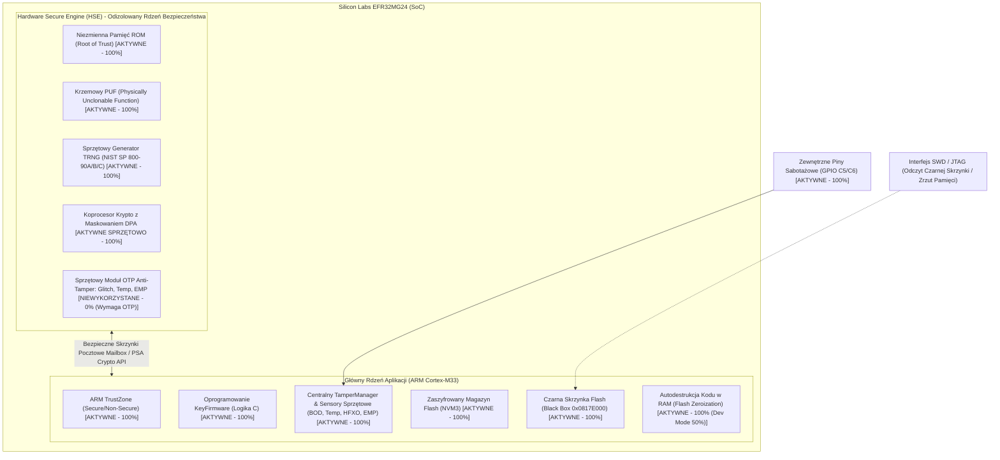
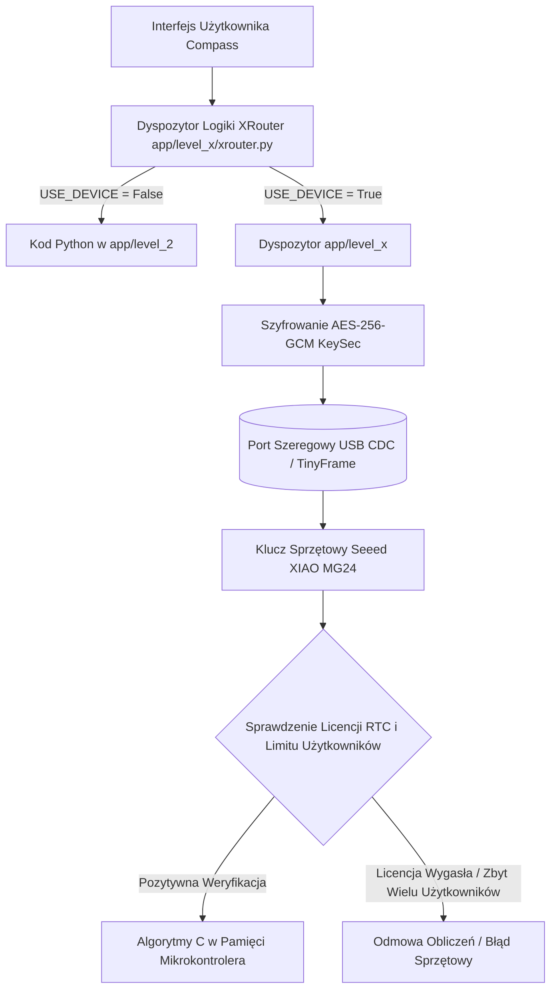
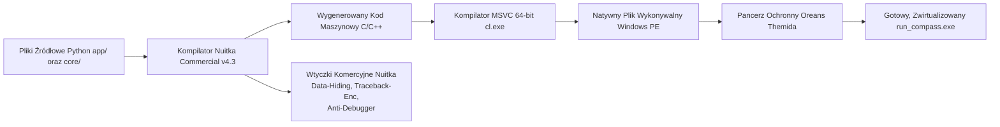
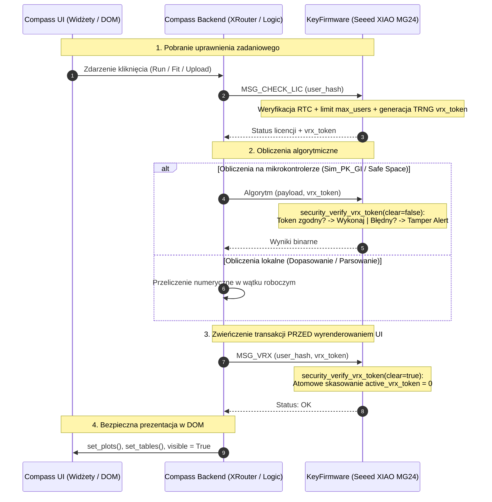

# Architektura Bezpieczeństwa i Mechanizmy Ochronne Aplikacji Compass

> **Status Dokumentu:** Wersja rozszerzona ze statusem wdrożenia funkcji mikrokontrolera ([AKTYWNE] vs [NIEWYKORZYSTANE])  
> **Zakres:** Aplikacja Compass (klient Windows), moduł KeySec (warstwa pośrednia API/transport) oraz KeyFirmware (klucz sprzętowy USB na bazie Seeed XIAO MG24 / Silicon Labs EFR32MG24)  
> **Poziom Weryfikacji:** 100% informacji potwierdzone w kodzie źródłowym repozytoriów `KeySec`, `KeyFirmware`, `compass` oraz w oficjalnej dokumentacji technicznej Silicon Labs (Gecko SDK / Simplicity SDK, karty katalogowe EFR32MG24, nota aplikacyjna AN1247).

---

## 1. Podsumowanie Architektury (Executive Summary)

Architektura bezpieczeństwa systemu Compass opiera się na **modelu zerowego zaufania (zero-trust)** oraz strategii **obrony w głąb (defense-in-depth)**. Zabezpieczenia zostały wdrożone na czterech niezależnych poziomach fizycznych i logicznych:

1. **Sprzętowe mechanizmy bezpieczeństwa krzemu (Silicon Labs EFR32MG24 / Secure Vault High / ARM TrustZone):** Układ SoC z certyfikatem **PSA Certified Level 3**, wyposażony w niezależny koprocesor bezpieczeństwa (Hardware Secure Engine - HSE), sprzętową izolację domen pamięci **ARM TrustZone (Cortex-M33)** z jednostką SAU, krzemową funkcję niekopiowalną (PUF), sprzętowe przeciwdziałanie atakom różnicowej analizy mocy (DPA), bezpieczny rozruch (Secure Boot RTSL), blokadę debugera (Secure Debug) oraz wbudowane detektory anomalii fizycznych.
2. **Fizyczna, środowiskowa i logiczna ochrona antysabotażowa (TamperManager):** Scentralizowany system zarządzania naruszeniami (**TamperManager**), zliczający incydenty według 10 kategorii (fizyczne krańcówki GPIO C5/C6, naruszenia protokołu VRX, sensory skrajnych temperatur próbkowane co 5s, detektory spadku napięcia BOD, anomalii oscylatora HFXO oraz impulsów EMP). System nadzoruje progi naruszeń, po przekroczeniu których uruchamiana jest procedura autodestrukcji i wymazywania kodu źródłowego programu z pamięci RAM (Flash Code Zeroization), przy jednoczesnym utrwaleniu rekordu Czarnej Skrzynki (Black Box) na wydzielonej stronie Flash (0x0817E000) do późniejszej analizy śledczej przez interfejs SWD.
3. **Bezpieczny kanał komunikacyjny (Szyfrowany Transport RPC):** Wzajemne uwierzytelnianie oparte o infrastrukturę klucza publicznego (PKI), efemeryczna wymiana kluczy ECDHE (krzywa NIST P-256) gwarantująca idealną poufność w przód (Perfect Forward Secrecy - PFS), unikalne dwukierunkowe klucze sesyjne wyprowadzane przez HKDF-SHA256, szyfrowanie symetryczne AES-256-GCM (AEAD) oraz ochrona przed atakami powtórzeniowymi (replay attack) za pomocą ścisłych liczników monotonicznych.
4. **Wyniesienie logiki biznesowej i prekompilacja kodu:** Całkowite usunięcie krytycznych algorytmów farmakokinetycznych ze środowiska Python na hoście. Przeniesienie kluczowych funkcji bezpośrednio do firmware'u mikrokontrolera oraz przepisanie ciężkich procedur numerycznych na natywne biblioteki C++ i prekompilowane moduły Clang.
5. **Wirtualizacja i utwardzenie binarne (Nuitka Commercial + Oreans Themida):** Kompilacja kodu Python bezpośrednio do natywnego kodu maszynowego C/C++ (usuwająca w 100% kod bajtowy `.pyc`), szyfrowanie ciągów znaków i stałych, zaciemnianie śladów stosu (traceback encryption) oraz opancerzenie pliku wykonywalnego silnikiem Themida (ochrona przed debugerami, zrzutami pamięci RAM, środowiskami wirtualnymi i wirtualizacja instrukcji procesora).

---

## 2. Zabezpieczenia Sprzętowe Mikrokontrolera Silicon Labs EFR32MG24 (Seeed XIAO MG24)

Klucz sprzętowy bazuje na miniaturowym module **Seeed Studio XIAO MG24**, którego sercem jest układ **Silicon Labs EFR32MG24** (rodzina Wireless Gecko Series 2). Układ ten posiada najwyższy dostępny w branży IoT pakiet sprzętowych zabezpieczeń krzemowych — **Secure Vault™ High**, certyfikowany oficjalnie na poziomie **PSA Certified Level 3** (najwyższy poziom certyfikacji konsorcjum ARM dla urządzeń brzegowych).

Poniżej przedstawiono szczegółowy stan wdrożenia każdego z mechanizmów mikrokontrolera: które funkcje są **[AKTYWNE]** w bieżącym kodzie produkcyjnym, a które pozostają **[NIEWYKORZYSTANE]** (obsługiwane sprzętowo przez krzem, lecz celowo nieaktywowane na obecnym etapie, np. aby uniknąć nieodwracalnego uszkodzenia płytek deweloperskich).



---

### 2.1 Architektura Podsystemu Secure Vault™ High: Status Wdrożenia

#### 1. Dedykowany Koprocesor Bezpieczeństwa (Hardware Secure Engine - HSE) — `[AKTYWNE]`
* **Opis sprzętowy:** Fizycznie odizolowany, niezależny koprocesor bezpieczeństwa z własnym rdzeniem CPU, pamięcią ROM, RAM i Flash, oddzielony sprzętowo od głównego rdzenia aplikacji (ARM Cortex-M33).
* **Stan w projekcie:** **`[AKTYWNE]`**. Oprogramowanie `KeyFirmware` wykorzystuje oficjalne API Silicon Labs **PSA Crypto**. Wszystkie klucze kryptograficzne i operacje matematyczne (ECC NIST P-256, ECDHE, AES-256-GCM, HKDF) są izolowane w koprocesorze HSE. Rdzeń Cortex-M33 nie ma bezpośredniego dostępu do rejestrów kryptograficznych, co zabezpiecza klucze przed wyciekiem w przypadku ewentualnych błędów pamięci w warstwie aplikacji.

#### 2. Bezpieczny Magazyn Kluczy i Krzemowy PUF (Key Wrapping) — `[AKTYWNE]`
* **Opis sprzętowy:** Krzemowa funkcja niekopiowalna (Physically Unclonable Function) generuje unikalny dla każdego egzemplarza krzemu cyfrowy odcisk palca (PUF Root Key) z losowych stanów startowych komórek SRAM. Służy do symetrycznego szyfrowania (wrappingu) kluczy przed zapisem do pamięci Flash.
* **Stan w projekcie:** **`[AKTYWNE]`**. Klucz tożsamości mikrokontrolera (`IDENTITY_KEY_ID = 0x00000001`) jest generowany bezpośrednio wewnątrz Secure Vault ([`auth_manager_provision_identity`](../../../KeyFirmware/src/crypto/auth_manager.c#L15)) i składowany w trwałej pamięci NVM3 w postaci zaszyfrowanej kluczem PUF. Żaden klucz prywatny nie istnieje w pamięci Flash w postaci jawnej. Fizyczny zrzut Flash programatorem uniemożliwia odzyskanie klucza.

#### 3. Środki Przeciwdziałania Atakom Bocznokanałowym DPA (Differential Power Analysis) — `[AKTYWNE SPRZĘTOWO]`
* **Opis sprzętowy:** Sprzętowe maskowanie poboru prądu (power flattening), losowe opóźnienia taktowania (clock jitter / dummy cycles) oraz maskowanie operandów w akceleratorach AES i ECC w celu uniemożliwienia odtworzenia klucza na podstawie oscyloskopowych pomiarów poboru mocy i emisji elektromagnetycznej.
* **Stan w projekcie:** **`[AKTYWNE SPRZĘTOWO]`**. Jest to cecha wbudowana na stałe w strukturę krzemową koprocesora Secure Vault High w układach EFR32MG24. Wszystkie operacje kryptograficzne wykonywane przez HSE korzystają z tej ochrony automatycznie i niezależnie od kodu aplikacji.

#### 4. Sprzętowy Generator Liczb Prawdziwie Losowych (TRNG) — `[AKTYWNE]`
* **Opis sprzętowy:** Generator liczb losowych czerpiący entropię z fizycznego szumu termicznego złącz półprzewodnikowych, zgodny z normami NIST SP 800-90A/B/C.
* **Stan w projekcie:** **`[AKTYWNE]`**. Wykorzystywany przez stos PSA Crypto do generowania efemerycznych par kluczy sesyjnych ECDHE oraz wektorów inicjalizujących na kluczu USB.

#### 5. Sensory Anomalii Zasilania (Voltage Glitch Detectors) — `[AKTYWNE PROGRAMOWO - 50%]`
* **Opis sprzętowy:** Detektory sprzętowe `VGLITCHFALLING` oraz `VGLITCHRISING` monitorujące linie zasilania pod kątem mikrosekundowych skoków lub zapadów napięcia, mających na celu wywołanie błędów w przetwarzaniu instrukcji warunkowych (fault injection).
* **Stan w projekcie:** **`[AKTYWNE PROGRAMOWO - 50%]`**. W oprogramowaniu układowym `KeyFirmware` wdrożono bezzwłoczną detekcję sprzętowych rejestrów spadku napięcia modułu EMU (`EMU->IF & (EMU_IF_AVDDBOD | EMU_IF_IOVDD0BOD)`) oraz procedurę zgłoszeniową `tamper_manager_report_voltage_glitch()`. Przekroczenie progu (2 incydenty) wyzwala procedurę autodestrukcji i zapisu Czarnej Skrzynki. Pełne 100% sprzętowej reakcji w koprocesorze Secure Engine wymaga nieodwracalnego zaprogramowania pamięci OTP (`sl_se_init_otp()`), co zostało odłożone do etapu produkcji masowej, aby chronić płytki deweloperskie przed zniszczeniem niestabilnym zasilaniem USB.

#### 6. Detektor Zakłóceń Zegara i Logiki Cyfrowej (`DGLITCH`) — `[AKTYWNE PROGRAMOWO - 50%]`
* **Opis sprzętowy:** Wbudowany układ monitorujący stabilność wewnętrznych generatorów taktujących i wykrywający asynchroniczne szpilki zegarowe (clock glitching).
* **Stan w projekcie:** **`[AKTYWNE PROGRAMOWO - 50%]`**. W oprogramowaniu układowym `KeyFirmware` aktywna jest detekcja sprzętowych anomalii i błędów buforowania oscylatora kwarcowego HFXO (`HFXO0->IF & (HFXO_IF_DNSERR | HFXO_IF_BUFOUTFREEZEERR | HFXO_IF_BUFOUTDNSERR)`) oraz API `tamper_manager_report_digital_glitch()`. Rejestracja anomalii zegarowej (próg 2 zdarzeń) inicjuje procedurę uceglenia. Pełne 100% wymaga aktywacji flagi `SL_SE_TAMPER_FLAG_DGLITCH_ALWAYS_ON` w rejestrach OTP Secure Engine.

#### 7. Sensory Skrajnych Temperatur — `[AKTYWNE PROGRAMOWO - 50%]`
* **Opis sprzętowy:** Zintegrowany sensor temperatury rdzenia z konfigurowalnym progiem alarmowym antysabotażowym w HSE (ochrona przed wymrażaniem do ataku Cold Boot lub przegrzewaniem do wywołania błędów logicznych).
* **Stan w projekcie:** **`[AKTYWNE PROGRAMOWO - 50%]`**. W pętli procesowej `tamper_manager_process()` wdrożono cykliczne próbkowanie zintegrowanego sensora termicznego `EMU_TemperatureGet()` co **5 sekund**. Zdefiniowano sztywne dopuszczalne granice pracy: dolną **`-10.0°C`** (ochrona przed wymrażaniem ciekłym azotem / freeze spray) oraz górną **`+70.0°C`** (ochrona przed przegrzewaniem hot-air). Trzykrotny odczyt poza granicami wyzwala procedurę autodestrukcji. Pełne 100% wymaga powiązania sygnału `SL_SE_TAMPER_SIGNAL_TEMPERATURE_SENSOR` z rejestrami OTP koprocesora HSE.

#### 8. Detektor Impulsów Elektromagnetycznych (EMP) — `[AKTYWNE PROGRAMOWO - 50%]`
* **Opis sprzętowy:** Blok detekcji silnych pól magnetycznych i promieniowania impulsowego stosowanego w atakach bocznych typu EM Fault Injection (EMFI).
* **Stan w projekcie:** **`[AKTYWNE PROGRAMOWO - 50%]`**. W kodzie `KeyFirmware` wdrożono dedykowane API `tamper_manager_report_emp()` oraz zasadę Zero Tolerance (próg = 1 zdarzenie). Dowolny zarejestrowany impuls EMP natychmiast wyzwala procedurę wymazywania Flash i zapis Czarnej Skrzynki. Pełne 100% powiązanie na poziomie mikrosekundowym wymaga uaktywnienia sygnału `SL_SE_TAMPER_ATAMPDET_EMPGD` w pamięci OTP Secure Engine.

#### 9. Trwałe Zerowanie Pamięci i Autodestrukcja Kodu Flash (Flash Code Zeroization) — `[AKTYWNE - 100% (Tryb Deweloperski 50%)]`
* **Opis sprzętowy:** Możliwość permanentnego, fizycznego wykasowania kodu źródłowego programu z pamięci Flash oraz danych krypto, uniemożliwiająca rozruch i inżynierię wsteczną (bricking), z jednoczesnym utrwaleniem audytowej Czarnej Skrzynki.
* **Stan w projekcie:** **`[AKTYWNE - 100% (Tryb Deweloperski 50%)]`**. Zaimplementowano funkcję `tamper_manager_self_destruct_ram()` umieszczoną w pamięci SRAM (`.ram_code`), która po przekroczeniu progu kasuje obszar NVM3 oraz strona po stronie cały kod programu od adresu `0x08000000` (strona 0 z wektorem resetu). Urządzenie zostaje trwale uceglone. Przed skasowaniem kodu, rekord audytowy `tamper_blackbox_t` jest trwale wypalany pod adresem `0x0817E000` (nienaruszanym podczas zerowania kodu). W kodzie wprowadzono przełącznik bezpieczeństwa `#define TAMPER_ENABLE_CODE_FLASH_SELF_DESTRUCT 0` (domyślny tryb deweloperski 50% symulujący zerowanie kodu bez uceglenia; ustawienie flagi na `1` aktywuje pełne fizyczne wymazanie 100%).

#### 10. Bezpieczny Rozruch z Weryfikacją Podpisu (Secure Boot z RTSL) — `[NIEWYKORZYSTANE]`
* **Opis sprzętowy:** Weryfikacja kryptograficznego podpisu asymetrycznego każdego wgrywanego obrazu firmware'u przez bootloader w pamięci ROM koprocesora HSE, wraz ze sprzętową blokadą cofania wersji (Anti-Rollback).
* **Stan w projekcie:** **`[NIEWYKORZYSTANE]`**. Klucze deweloperskie Seeed XIAO MG24 mają obecnie wyłączoną weryfikację podpisu bootloadera, co pozwala programistom na swobodne wgrywanie nowego kodu przez skrypt `xiao_mg24_flash.bat` bez konieczności każdorazowego certyfikowania binarnego obrazu kluczem produkcyjnym producenta.

#### 11. Kryptograficzna Blokada Debugera (Secure Debug with Lock/Unlock) — `[NIEWYKORZYSTANE]`
* **Opis sprzętowy:** Trwałe zablokowanie magistrali SWD/JTAG z możliwością bezpiecznego, kryptograficznego odblokowania jej wyłącznie tokenem podpisanym kluczem Command Key producenta.
* **Stan w projekcie:** **`[NIEWYKORZYSTANE]`**. Port SWD płytki Seeed XIAO MG24 pozostaje obecnie otwarty (unlocked), co umożliwia bezpośrednie programowanie i zbieranie logów za pośrednictwem adaptera J-Link / CMSIS-DAP. Zablokowanie portu zostanie przeprowadzone na partii urządzeń przeznaczonych dla użytkowników końcowych.

#### 12. Sprzętowa Poświadczalność Fabryczna Silicon Labs (Secure Attestation) — `[NIEWYKORZYSTANE]`
* **Opis sprzętowy:** Weryfikacja fabrycznego łańcucha certyfikatów i klucza wsadowego wstrzykniętego przez Silicon Labs na etapie produkcji krzemu.
* **Stan w projekcie:** **`[NIEWYKORZYSTANE]`**. Autentyczność urządzenia jest obecnie weryfikowana za pomocą **własnej infrastruktury PKI producenta oprogramowania** (Root CA $\to$ Device Certificate w NVM3 wygenerowany podczas provisioning dongle'a). Certyfikat fabryczny Silicon Labs nie jest obecnie odpytywany przez aplikację Compass.

#### 13. Sprzętowa Izolacja ARM TrustZone (Cortex-M33) — `[AKTYWNE - 100%]`
* **Opis sprzętowy:** Sprzętowy podział przestrzeni adresowej rdzenia Cortex-M33 na strefę bezpieczną (Secure World), strefę bramek wejściowych (Non-Secure Callable - NSC) oraz strefę ogólną (Non-Secure World) za pomocą zintegrowanej jednostki SAU (Security Attribution Unit).
* **Stan w projekcie:** **`[AKTYWNE - 100%]`**. Pamięć Flash i RAM mikrokontrolera zostały sprzętowo podzielone przez SAU. Strefa Secure izoluje autorskie algorytmy Compass IP, operacje kryptograficzne, zegar RTC, limit użytkowników oraz centralny TamperManager. Strefa Non-Secure obsługuje parser `cJSON` oraz protokół komunikacyjny TinyFrame/USB, łącząc się ze strefą Secure wyłącznie przez bramki NSC z walidacją wskaźników CMSE. Szczegółowy opis implementacji w Rozdziale 2.6.

---

### 2.2 Fizyczna Pętla Antysabotażowa (Anti-Tamper Wire i Krańcówki Obudowy) — `[AKTYWNE - 100%]`

#### Implementacja Fizyczna w Kluczu XIAO MG24
* **Pliki źródłowe:** [`KeyFirmware/src/core/tamper_simulation.c`](../../../KeyFirmware/src/core/tamper_simulation.c) oraz [`tamper_manager.c`](../../../KeyFirmware/src/core/tamper_manager.c).
* **Konfiguracja pinów GPIO:**
  * Kanał Tamper 1: Port C, Pin 5 (`TAMPER1_PORT SL_GPIO_PORT_C`, `TAMPER1_PIN 5`).
  * Kanał Tamper 2: Port C, Pin 6 (`TAMPER2_PORT SL_GPIO_PORT_C`, `TAMPER2_PIN 6`).
* **Tryb pracy sprzętowej:**
  * Piny są konfigurowane przez funkcję `sl_gpio_set_pin_mode(&tamper_gpio, SL_GPIO_MODE_INPUT_PULL_FILTER, 1)`. Wbudowany w procesor rezystor podciągający (pull-up) jest aktywny, a wbudowany cyfrowy filtr zakłóceń (glitch filter) eliminuje fałszywe wzbudzenia wywołane szumem elektromagnetycznym.
  * W stanie nienaruszonym (obudowa zamknięta), pętla z cienkiego przewodu miedzianego lub styk krańcówki wewnątrz obudowy zwiera pin bezpośrednio do masy (GND), wymuszając logiczny stan niski (`0`).
* **Detekcja Naruszenia (Przerwanie Sprzętowe Zboczem Rosnącym):**
  * W momencie otwarcia obudowy, próby podważenia, przecięcia przewodu lub jego odlutowania obwód zostaje przerwany.
  * Rezystor podciągający natychmiast podnosi napięcie na wejściu mikrokontrolera do poziomu $V_{CC}$ (stan logiczny `1`).
  * Wyzwala to sprzętowe przerwanie mikrokontrolera konfigurowane w rejestrach NVIC za pośrednictwem `sl_gpio_configure_external_interrupt(&tamper_gpio, &int_no, SL_GPIO_INTERRUPT_RISING_EDGE, tamper_callback, NULL)`.
* **Reakcja Oprogramowania Układowego (Firmware):**
  * Procedura obsługi przerwania (`tamper1_callback` / `tamper2_callback`) ustawia flagę przerwaniową, która w pętli procesowej wywołuje `tamper_manager_detected(TAMPER_TYPE_PHYSICAL_PIN1/PIN2, "...")`.
  * Centralny menedżer inkrementuje liczniki naruszeń, wysyła alert przez `send_log()`, uruchamia 1-sekundowy nieblokujący impuls diody LED (`sl_led_led`) oraz nadzoruje próg autodestrukcji (próg 3 zdarzeń).
  * Stan zdarzeń sabotażowych jest raportowany do aplikacji Windows poleceniem `MSG_SYS_HEALTH` (`TamperEvents:X, Temp:Y.ZC, BlackBox:ARMED`).

---

### 2.3 Scentralizowany Menedżer Sabotażu (TamperManager), Czarna Skrzynka i Autodestrukcja Kodu Flash — `[AKTYWNE - 100%]`

W oprogramowaniu `KeyFirmware` zaimplementowano scentralizowaną klasę i moduł zarządzania wszystkimi incydentami bezpieczeństwa ([`tamper_manager.h`](../../../KeyFirmware/src/core/tamper_manager.h) oraz [`tamper_manager.c`](../../../KeyFirmware/src/core/tamper_manager.c)). Wszystkie rozproszone dotąd punkty detekcji fizycznej, środowiskowej i logicznej podlegają jednolitej ewidencji, telemetrii i automatycznej reakcji obronnej.

```
┌──────────────────────────────────────────────────────────────────────────────────┐
│                      FIZYCZNA PAMIĘĆ FLASH EFR32MG24 (1536 KB)                   │
├──────────────────────────────────────┬──────────────────────┬────────────────────┤
│   KOD ŹRÓDŁOWY / FIRMWARE (Aplikacja)│      OBSZAR NVM3     │ CZARNA SKRZYNKA    │
│    (0x08000000 do 0x0817C000)        │ (0x08160000-0x17E000)│ (0x0817E000-0x180) │
│                                      │                      │                    │
│ - Wektory przerwań / Reset vector    │ - Licencje, certyfik.│ - Magiczny nagłówek│
│ - Algorytmy i funkcja główna         │ - Sesje użytkowników │ - Liczniki ataków  │
│ - Sekcje .text, .rodata              │ - Dane kryptograf.   │ - Typ ataku & Meta │
│                                      │                      │ - Odczyty V i Temp │
├──────────────────────────────────────┴──────────────────────┼────────────────────┤
│                  CAŁKOWICIE KASOWANE W RAM:                 │    POZOSTAJE DO    │
│              - Kod programu wymazany (0xFF)                 │     EKSTRAKCJI     │
│              - Urządzenie permanentnie uceglone             │    ŚLEDCZEJ PO     │
│              - Niemożliwy reverse-engineering               │     SWD / J-LINK   │
└─────────────────────────────────────────────────────────────┴────────────────────┘
```

#### 1. Architektura i Kategorie Tamperów (`tamper_type_t`)
Moduł definiuje 10 ścisłych kategorii naruszeń wraz z przypisanymi progami autodestrukcji:

| ID Typu | Identyfikator Enum | Źródło i Opis Zdarzenia | Próg do Autodestrukcji |
|:---:|---|---|:---:|
| 0 | `TAMPER_TYPE_PHYSICAL_PIN1` | Fizyczne otwarcie obudowy (krańcówka PC5) | **3** |
| 1 | `TAMPER_TYPE_PHYSICAL_PIN2` | Przecięcie siatki / pętli przewodzącej (PC6) | **3** |
| 2 | `TAMPER_TYPE_LOGICAL_VRX_SHORT` | Zmanipulowany / ucięty pakiet protokołu VRX (<8 bajtów) | **5** |
| 3 | `TAMPER_TYPE_LOGICAL_VRX_INVALID` | Puste parametry uwierzytelniające VRX (user_hash/token == 0) | **5** |
| 4 | `TAMPER_TYPE_LOGICAL_VRX_MISMATCH` | Niezgodny token VRX (próba ataku brute-force sesji) | **3** |
| 5 | `TAMPER_TYPE_LOGICAL_VRX_NO_SESSION` | Zapytanie VRX dla nieistniejącej sesji użytkownika | **5** |
| 6 | `TAMPER_TYPE_TEMP_EXTREME` | Skrajna temperatura (< -10°C lub > 70°C), próbkowanie co 5s | **3** |
| 7 | `TAMPER_TYPE_VOLTAGE_GLITCH` | Spadek/anomalia napięcia zasilania (BOD / VMON < 2.0V) | **2** |
| 8 | `TAMPER_TYPE_DIGITAL_GLITCH` | Zakłócenie taktowania lub logiki (anomalie oscylatora HFXO0) | **2** |
| 9 | `TAMPER_TYPE_EMP` | Impuls elektromagnetyczny (EMP) — zasada Zero Tolerance | **1** |

#### 2. Działanie Metody `tamper_manager_detected()`
Gdy dowolny moduł firmware wykryje anomalię, wywołuje centralną metodę:
`tamper_manager_detected(tamper_type_t type, const char *metadata)`.
1. **Ewidencja:** Zwiększa dedykowany licznik danego typu `tamper_counts[type]++` oraz globalny licznik `tamper_event_count++`.
2. **Sygnalizacja Diodą LED:** Załącza diodę LED (`sl_led_turn_on(&sl_led_led)`) i uruchamia nieblokujący timer sprzętowy (`sl_sleeptimer_restart_timer_ms(&tamper_led_timer, 1000, ...)`), który po dokładnie **1 sekundzie** wyłącza diodę. Stan alarmu jest chroniony flagą `tamper_led_active`, uniemożliwiającą zgaszenie alertu przez rutynowe heartbeaty komunikacyjne.
3. **Telemetria:** Formatuje i emituje ustrukturyzowany komunikat dziennika zdarzeń przez `send_log()`:
   `"SECURITY ALERT: Tamper 'Nazwa' (#Total, total: Typ/Próg) [Metadane]"`.
4. **Weryfikacja Progu:** Sprawdza, czy `tamper_counts[type] >= tamper_thresholds[type]`. W razie osiągnięcia limitu następuje natychmiastowe uruchomienie procedury autodestrukcji `tamper_manager_trigger_wipe()`.

#### 3. Zapis Trwałej Czarnej Skrzynki (Forensic Black Box w Pamięci Flash)
Zanim jakikolwiek kod zostanie naruszony, menedżer przygotowuje strukturę `tamper_blackbox_t` (dokładnie 192 bajty, wyrównane do 4 bajtów):
```c
typedef struct __attribute__((packed, aligned(4))) {
    uint32_t magic;                          // Sygnatura poprawności: 0x54414D50 ("TAMP")
    uint32_t timestamp;                      // Czas uniksowy z RTC w momencie ataku
    uint32_t uptime_seconds;                 // Czas pracy urządzenia od włączenia zasilania
    uint8_t  triggering_tamper_type;         // Typ tampera, który wymusił autodestrukcję
    uint8_t  reserved[3];                    // Wyrównanie do 4 bajtów
    uint32_t tamper_counts[10];              // Statystyka zdarzeń dla wszystkich 10 typów
    int16_t  temperature_x10;                // Odczyt temperatury (°C * 10)
    uint16_t voltage_mv;                     // Odczyt napięcia zasilania (mV)
    char     incident_description[128];      // Czytelny opis incydentu i metadane
    uint32_t crc32;                          // Suma kontrolna IEEE 802.3
} tamper_blackbox_t;
```
Rekord ten zostaje utrwalony na dedykowanej stronie pamięci Flash pod adresem **`0x0817E000`** (ostatnia strona 8 KB fizycznej pamięci 1536 KB, znajdująca się poza zakresem kodu i NVM3) za pomocą kontrolera MSC (`MSC_ErasePage()` i `MSC_WriteWord()`).

#### 4. Autodestrukcja Kodu Źródłowego z Pamięci RAM (Flash Code Zeroization)
W architekturze ARM Cortex-M33 rdzeń nie może wymazywać stron Flash, z których aktualnie wykonuje instrukcje. Z tego powodu procedura wymazująca została zaimplementowana jako funkcja RAM:
`SL_RAMFUNC_DEFINITION_BEGIN void tamper_manager_self_destruct_ram(void)`:
1. **Alokacja w SRAM:** Funkcja zostaje skompilowana do sekcji `.ram_code` (adres w pamięci SRAM: `0x2003534c`). Flaga linkera `-utamper_manager_self_destruct_ram` gwarantuje, że optymalizator `--gc-sections` nie usunie procedury z pliku wykonywalnego.
2. **Brak zależności od Flash:** Procedura bezpośrednio odblokowuje rejestr kontrolera pamięci (`MSC->LOCK = MSC_LOCK_LOCKKEY_UNLOCK;`), nie wykonując żadnych skoków do pamięci Flash.
3. **Fizyczne Wymazanie Kodu:** W pętli kasuje strona po stronie całą przestrzeń kodu aplikacji od strony 0 (`0x08000000`) do `0x0817C000` (łącznie 191 stron po 8 KB = 1528 KB). Po wymazaniu strony 0 wektor resetu i tablica wektorów przerwań zostają wyzerowane (`0xFFFFFFFF`), trwale uniemożliwiając rozruch i reverse-engineering. Strona Czarnej Skrzynki `0x0817E000` pozostaje nienaruszona.
4. **Zatrzymanie Rdzenia:** Procesor przechodzi w nieskończoną pętlę uśpienia `while(1) { __WFI(); }`.

#### 5. Instrukcja Odczytu Logów po Ucegleniu (Forensic Extraction Guide)
Gdy urządzenie utraciło oprogramowanie i nie komunikuje się przez port szeregowy, logi odczytuje się przez magistralę SWD programatora:
```bash
# Zrzut 512 bajtów Czarnej Skrzynki do pliku binarnego:
commander readmem --range 0x0817E000:+512 -d EFR32MG24B220F1536IM48 --outfile blackbox_dump.bin

# Bezpośredni podgląd pamięci Flash w konsoli (widoczna sygnatura TAMP, parametry i opis incydentu):
commander readmem --range 0x0817E000:+256 -d EFR32MG24B220F1536IM48
```

---

### 2.4 Szyfrowany Kanał Komunikacyjny (Szyfrowany Transport RPC) — `[AKTYWNE]`

#### Protokół Transportowy i Ramkowanie Danych
* Komunikacja z kluczem USB odbywa się przez wirtualny port szeregowy (VCOM / USB CDC) z prędkością 115200 bps.
* Na warstwie binarnej zastosowano protokół **TinyFrame** ([`KeyFirmware/src/TinyFrame.c`](../../../KeyFirmware/src/TinyFrame.c) oraz [`KeySec/core/transport.py`](../../core/transport.py)), zapewniający podział na ramki, kontrolę spójności sumami CRC16/CRC32 oraz trasowanie zapytań RPC.

#### Silnik Kryptograficzny i Algorytmy
* **Po stronie mikrokontrolera:** Oficjalne API **Silicon Labs PSA Crypto** ([`KeyFirmware/src/crypto/session_ecdhe.c`](../../../KeyFirmware/src/crypto/session_ecdhe.c), [`KeyFirmware/src/crypto/auth_manager.c`](../../../KeyFirmware/src/crypto/auth_manager.c)), bezpośrednio sprzężone ze sprzętowym akceleratorem kryptograficznym Secure Vault High.
* **Po stronie aplikacji Windows:** Standardowa, audytowana biblioteka `cryptography.hazmat` ([`KeySec/core/secure_channel.py`](../../core/secure_channel.py)).
* **Negocjacja Klucza Sesji (ECDHE - Elliptic-Curve Diffie-Hellman Ephemeral):**
  * Krzywa eliptyczna: NIST P-256 (`PSA_ECC_FAMILY_SECP_R1` / `ec.SECP256R1`).
  * Gwarancja poufności w przód (Perfect Forward Secrecy - PFS): Przy każdym podłączeniu dongle'a lub uruchomieniu aplikacji generowana jest świeża, tymczasowa para kluczy asymetrycznych po stronie PC (`pc_priv`) oraz świeży 32-bajtowy kryptograficzny nonce losowy (`pc_nonce`). Mikrokontroler generuje własną parę efemeryczną w pamięci RAM (`psa_generate_key`).
  * Operacja uzgadniania klucza oblicza 32-bajtowy sekret współdzielony (Shared Secret) w sprzętowym koprocesorze (`psa_raw_key_agreement` na MCU, `pc_priv.exchange` na PC).
  * Klucze efemeryczne są bezpowrotnie niszczone w pamięci RAM natychmiast po wyprowadzeniu kluczy sesyjnych.
* **Wyprowadzanie Dwukierunkowych Kluczy Sesyjnych (HKDF-SHA256):**
  * Zamiast używać jednego symetrycznego klucza do nadawania i odbierania, algorytm HKDF-SHA256 generuje **dwa odrębne, 256-bitowe klucze AES** z użyciem soli `pc_nonce`:
    * Klucz kierunku Host $\to$ Urządzenie (Info: `b"KEYSEC_CLIENT_WRITE_KEY_V1"`): służy do szyfrowania po stronie PC. W mikrokontrolerze klucz ten otrzymuje rygorystyczne uprawnienie `PSA_KEY_USAGE_DECRYPT` (tylko deszyfrowanie).
    * Klucz kierunku Urządzenie $\to$ Host (Info: `b"KEYSEC_SERVER_WRITE_KEY_V1"`): służy do szyfrowania odpowiedzi przez mikrokontroler (`PSA_KEY_USAGE_ENCRYPT`).
* **Szyfrowanie Danych i Ochrona Przed Atakami Powtórzeniowymi (AES-256-GCM):**
  * Szyfr symetryczny: AES-256-GCM z 128-bitowym tagiem uwierzytelniającym (AEAD - Authenticated Encryption with Associated Data).
  * Konstrukcja 12-bajtowego wektora początkowego (Nonce):
    $$\text{Nonce} = [\text{4 bajty: licznik monotoniczny uint32\_le}] \,||\, [\text{1 bajt: identyfikator kierunku}] \,||\, [\text{7 bajtów: zera}]$$
    * Bajt kierunku przyjmuje wartość `0x01` dla transmisji PC $\to$ Dongle oraz `0x02` dla transmisji Dongle $\to$ PC.
  * Optymalizacja pasma UART: Na magistralę przesyłany jest jedynie 4-bajtowy licznik, szyfrogram oraz 16-bajtowy tag uwierzytelniający.
  * Ochrona anty-replay (Monotonic Counter Check): Zarówno PC ([`SecureChannel.decrypt_payload()`](../../core/secure_channel.py#L162-L184)), jak i mikrokontroler ([`session_decrypt_payload()`](../../../KeyFirmware/src/crypto/session_ecdhe.c)) weryfikują monotoniczność licznika. Otrzymanie pakietu z licznikiem $\le$ ostatnio zarejestrowany natychmiast zrywa transmisję jako atak powtórzeniowy.

---

### 2.5 Unikalne Zestawy Kluczy per Klient i Infrastruktura PKI — `[AKTYWNE]`

#### Architektura Kluczy Fabrycznych i Sprzętowych
* Źródło dokumentacji: [`KeySec/docs/security/cryptography_flow_and_keys.md`](../../docs/security/cryptography_flow_and_keys.md).
* Implementacja w skryptach: [`KeySec/scripts/generate_root_ca.py`](../../scripts/generate_root_ca.py) oraz [`KeySec/scripts/provision_dongle.py`](../../scripts/provision_dongle.py).

| Nazwa Klucza / Certyfikatu | Miejsce Generowania | Miejsce Przechowywania | Rola w Systemie i Cel Ochrony | Status |
|---|---|---|---|:---:|
| **Root CA Private Key** (`root_ca_key.pem`) | Izolowany komputer producenta ([`generate_root_ca.py`](../../scripts/generate_root_ca.py)) | Bezpieczny magazyn offline. **Nigdy nie trafia do klienta.** | Podpisywanie certyfikatów tożsamości dla nowo produkowanych kluczy sprzętowych (Provisioning). | **`[AKTYWNE]`** |
| **Root CA Public Key** (`root_ca_pub.pem`) | Wyprowadzony z klucza prywatnego Root CA | Wbudowany bezpośrednio w plik wykonywalny i paczkę aplikacji Compass | Weryfikacja autentyczności podłączonego klucza sprzętowego przez aplikację. | **`[AKTYWNE]`** |
| **Sprzętowy Klucz Główny PUF (Root Key)** | Struktura krzemowa EFR32MG24 (losowy rozkład ładunków SRAM przy starcie) | Rejestr sprzętowy Secure Engine, niedostępny dla rdzenia Cortex-M33 | Używany przez sprzęt do szyfrowania i bezpiecznego owijania (wrapping) pozostałych kluczy we Flashu. | **`[AKTYWNE]`** |
| **Klucz Tożsamości Urządzenia (Identity Key)** | Generowany wewnątrz Secure Vault na etapie produkcji ([`AdminApi.provision_identity()`](../../scripts/provision_dongle.py#L34)) | Pamięć NVM3 mikrokontrolera pod ochroną PUF (`IDENTITY_KEY_ID = 0x00000001`). Klucz prywatny nigdy nie opuszcza krzemu w postaci jawnej. | Unikalna tożsamość urządzenia. Służy wyłącznie do podpisywania wyzwania kryptograficznego podczas nawiązywania połączenia USB. | **`[AKTYWNE]`** |
| **Certyfikat Urządzenia (Device Certificate)** | Podpisany przez Root CA w fazie produkcji ([`provision_dongle.py`](../../scripts/provision_dongle.py#L43-L57)) | Trwała pamięć NVM3 mikrokontrolera ([`security_nvm_save_certificate()`](../../../KeyFirmware/src/rpc_router.c#L263)) | Wiąże dany egzemplarz mikrokontrolera z fabryką producenta. | **`[AKTYWNE]`** |

#### Przebieg Wzajemnego Uwierzytelniania (Ochrona przed Klonowaniem i Atakami Man-in-the-Middle)
1. Aplikacja wysyła zapytanie powitalne [`MSG_HANDSHAKE_INIT`](../../core/secure_channel.py#L45) zawierające klucz efemeryczny PC oraz losowy nonce `pc_nonce`.
2. Mikrokontroler generuje efemeryczną parę kluczy, łączy `pc_nonce || mcu_eph_pub`, oblicza skrót SHA-256 i podpisuje go kryptograficznie (ECDSA) swoim ukrytym w krzemie kluczem tożsamości ([`auth_manager_sign_digest`](../../../KeyFirmware/src/crypto/session_ecdhe.c#L164)).
3. Mikrokontroler zwraca swój klucz efemeryczny, publiczny klucz tożsamości, podpis wyzwania oraz certyfikat podpisany przez Root CA.
4. **Weryfikacja Krok 1 (PC):** Aplikacja Compass weryfikuje podpis na certyfikacie dongle'a za pomocą wbudowanego klucza publicznego `root_ca_pub.pem` ([`SecureChannel.init_handshake()`](../../core/secure_channel.py#L76-L86)). Fałszywy klucz USB nie przejdzie tego testu.
5. **Weryfikacja Krok 2 (PC):** Aplikacja sprawdza podpis wyzwania za pomocą zweryfikowanego klucza tożsamości mikrokontrolera ([`SecureChannel.init_handshake()`](../../core/secure_channel.py#L88-L113)). Uniemożliwia to atak typu replay lub podsłuch i manipulację transmisją przez oprogramowanie trzecie.

---

### 2.6 Sprzętowa Izolacja Domen Pamięci ARM TrustZone (Cortex-M33) — `[AKTYWNE - 100%]`

#### Architektura Podziału w Krzemie (SAU / SMU)
W oprogramowaniu `KeyFirmware` zaimplementowano pełną separację fizycznych domen bezpieczeństwa ARMv8-M na rdzeniu Cortex-M33 mikrokontrolera EFR32MG24 ([`src/secure/sec_boot.c`](../../../KeyFirmware/src/secure/sec_boot.c), [`linkerfile_s.ld`](../../../KeyFirmware/cmake_gcc/linkerfile_s.ld), [`linkerfile_ns.ld`](../../../KeyFirmware/cmake_gcc/linkerfile_ns.ld)). Sprzętowa jednostka **SAU (Security Attribution Unit)** dzieli 1536 KB pamięci Flash oraz 256 KB pamięci RAM na dwa odizolowane światy:

| Domena Pamięci | Zakres Adresów | Rozmiar | Zawartość i Rola w Systemie |
|---|---|---|---|
| **Secure Flash** | `0x08000000 - 0x0802FFFF` | 192 KB | Kod startowy Secure, algorytmy Compass IP, kryptografia, weryfikator licencji RTC, limit użytkowników, TamperManager. |
| **NSC Flash (Gateway)** | `0x08030000 - 0x08037FFF` | 32 KB | Bramki tranzytowe z instrukcją `SG` (*Secure Gateway*) eksportujące bezpieczne API (`cmse_nonsecure_entry`). |
| **Non-Secure Flash** | `0x08038000 - 0x08147FFF` | 1088 KB | Parser JSON (`cJSON.c`), obsługa stosu TinyFrame, sterowniki USB CDC/EUSART, routery komend (`prod_router.c`). |
| **Secure NVM3** | `0x08148000 - 0x08167FFF` | 128 KB | Odizolowany magazyn tokenów licencyjnych, tożsamości urządzenia i znaczników antysabotażowych. |
| **Non-Secure NVM3** | `0x08168000 - 0x0817DFFF` | 104 KB | Dane i konfiguracja ogólna użytkownika. |
| **Secure RAM** | `0x20000000 - 0x2000FFFF` | 64 KB | Stos Secure `MSP_S`, dynamiczna sterta krypto, wrażliwe bufory obliczeniowe algorytmów farmakokinetycznych. |
| **Non-Secure RAM** | `0x20010000 - 0x2003FFFF` | 192 KB | Stos Non-Secure `MSP_NS`, drzewo DOM cJSON, bufory ramkowania transmisji USB TinyFrame. |

#### Bramki Wejściowe NSC i Ochrona przed Atakiem Confused Deputy
1. **Instrukcja `SG` (Secure Gateway):** Świat Non-Secure nie ma fizycznej możliwości skoczenia pod dowolny adres strefy Secure (sprzętowy wyjątek `SecureFault`). Jedyne legalne punkty wejścia to bramki NSC zadeklarowane w [`src/secure/nsc_interface.c`](../../../KeyFirmware/src/secure/nsc_interface.c) z atrybutem `__attribute__((cmse_nonsecure_entry))`.
2. **Weryfikacja Wskaźników CMSE:** Każdy bufor wejściowy i wyjściowy przekazywany z Non-Secure do Secure podlega sprzętowej weryfikacji funkcją `cmse_check_address_range(buf, len, CMSE_NONSECURE | ...)`. Uniemożliwia to złośliwemu kodowi w strefie NS przekazanie wskaźnika celującego w Secure RAM w celu jego odczytania lub nadpisania.
3. **Izolacja Błędów Parserów:** Błędy pamięciowe (np. przepełnienie sterty w `cJSON` lub błąd bufora w TinyFrame) są fizycznie uwięzione w strefie Non-Secure RAM. Atakujący przez interfejs USB nie jest w stanie zmodyfikować daty ważności licencji, zmanipulować zegara RTC ani wykraść autorskich algorytmów z pamięci Secure Flash/RAM.

---

## 3. Zabezpieczenia Przed Atakiem na Aplikację Compass

### 3.1 Wyniesienie Logiki Algorytmicznej Bezpośrednio na Mikrokontroler — `[AKTYWNE]`

Zamiast wykonywać całe przetwarzanie danych w środowisku Python na komputerze użytkownika, krytyczne fragmenty kodu zostały całkowicie z niego wycięte i zaimplementowane w pamięci mikrokontrolera. Dyspozytor logiki [`compass/app/level_x/xrouter.py`](../../../compass/app/level_x/xrouter.py) sprawdza flagę sprzętową `USE_DEVICE`.



#### 1. `level_2 / set_safe_space_estimates` — `[AKTYWNE]`
* **Implementacja Python (fallback):** [`compass/app/level_2/set_safe_space_estimates.py`](../../../compass/app/level_2/set_safe_space_estimates.py)
* **Kierowanie sprzętowe:** [`compass/app/level_x/set_safe_space_estimates.py`](../../../compass/app/level_x/set_safe_space_estimates.py) $\to$ [`KeySec/logic/safe_space_estimates.py`](../../logic/safe_space_estimates.py) ([`SafeSpaceEstimatesRunner`](../../logic/safe_space_estimates.py#L8))
* **Kod C w mikrokontrolerze:** [`KeyFirmware/src/logic/safe_space_estimates.c`](../../../KeyFirmware/src/logic/safe_space_estimates.c)
* **Mechanizm działania:**
  * Parametry wejściowe uwalniania (`sfsp_FaSSGF`, `sfsp_FaSSIF`, `CsS`, `zS`, `CsI`, `zI`, `tlagS`, `tlagI`) są pakowane w binarną strukturę i wysyłane przez [`MSG_SAFE_SPACE_INIT`](../../logic/safe_space_estimates.py#L50).
  * Dane punktów uwalniania są strumieniowane w binarnych pakietach po 1491 bajtów ([`MSG_SAFE_SPACE_CHUNK`](../../logic/safe_space_estimates.py#L75)).
  * Mikrokontroler w bezpiecznym rdzeniu C wylicza szacunki bezpiecznej przestrzeni (safe space), granice zmienności i opóźnienia, po czym zwraca wynik poleceniem [`MSG_SAFE_SPACE_READ`](../../logic/safe_space_estimates.py#L92).

#### 2. `level_2 / set_safe_space_plots` — `[AKTYWNE]`
* **Implementacja Python (fallback):** [`compass/app/level_2/set_safe_space_plots.py`](../../../compass/app/level_2/set_safe_space_plots.py)
* **Kierowanie sprzętowe:** [`compass/app/level_x/set_safe_space_plots.py`](../../../compass/app/level_x/set_safe_space_plots.py) $\to$ [`KeySec/logic/safe_space_plots.py`](../../logic/safe_space_plots.py)
* **Kod C w mikrokontrolerze:** [`KeyFirmware/src/logic/safe_space_plots.c`](../../../KeyFirmware/src/logic/safe_space_plots.c)
* **Podział na procedury sprzętowe:**
  * **Procedura A ([`execute_safe_space_plots_A`](../../logic/safe_space_plots.py#L11)):** Strumieniowanie punktów uwalniania przez `MSG_SSP_A_CHUNK` (`<BffB`). Mikrokontroler agreguje w pamięci C obwiednie minimalne i maksymalne (`min`/`max`) dla mediów FaSSGF oraz FaSSIF.
  * **Procedura B ([`execute_safe_space_plots_B`](../../logic/safe_space_plots.py#L56)):** Zapytanie `MSG_SSP_B_REQ` (`<BBBB`). Mikrokontroler wylicza logiczny warunek widoczności wewnętrznych granic zmienności na podstawie trybu uwalniania i tolerancji opóźnienia.
  * **Procedura C ([`execute_safe_space_plots_C`](../../logic/safe_space_plots.py#L67)):** Strumieniowanie danych eksperymentalnych formulacji przez `MSG_SSP_C_CHUNK` (`<BBff`). Mikrokontroler przeprowadza rygorystyczną filtrację rekordów według medium, formulacji i progów czasowych.

#### 3. `level_2 / Sim_PK_and_GI_table` — `[AKTYWNE]`
* **Implementacja Python (fallback):** [`compass/app/level_2/Sim_PK_and_GI_table.py`](../../../compass/app/level_2/Sim_PK_and_GI_table.py)
* **Kierowanie sprzętowe:** [`compass/app/level_x/Sim_PK_and_GI_table.py`](../../../compass/app/level_x/Sim_PK_and_GI_table.py) $\to$ [`KeySec/logic/sim_pk_gi.py`](../../logic/sim_pk_gi.py) ([`SimPkGiRunner`](../../logic/sim_pk_gi.py#L6))
* **Kod C w mikrokontrolerze:** [`KeyFirmware/src/logic/sim_pk_gi.c`](../../../KeyFirmware/src/logic/sim_pk_gi.c)
* **Przebieg:** Strumieniowanie macierzy symulacyjnych przewodu pokarmowego i parametrów farmakokinetycznych przez `MSG_SIM_PK_GI_INIT/CHUNK`, przeliczenie danych wewnątrz układu Cortex-M33 i odczyt sformatowanego wyniku przez `MSG_SIM_PK_GI_READ`.

#### 4. Bramki Sprzętowe: Licencja Czasowa oraz Limit Równoczesnych Użytkowników — `[AKTYWNE]`
Przed wykonaniem jakiejkolwiek procedury matematycznej firmware sprawdza wewnętrzne warunki bezpieczeństwa:
* **Sprzętowa kontrola licencji czasowej:** Procedura [`security_rtc_check_license()`](../../../KeyFirmware/src/security_rtc.c#L130) weryfikuje bieżący czas uniksowy zliczanego zegara RTC względem okresu zapisanego w NVM3. Blokuje ataki polegające na cofaniu daty w systemie Windows (próba synchronizacji wstecznej jest traktowana jako sabotaż i odrzucana).
* **Sprzętowy limit aktywnych użytkowników (okno 10-minutowe):** Procedura [`security_users_register_activity()`](../../../KeyFirmware/src/security_users.c#L18) przechowuje w pamięci RAM skróty (hashe) unikalnych sesji użytkowników. Jeśli w ciągu ostatnich 10 minut (600 sekund) liczba aktywnych sesji przekroczy limit `MAX_USERS` (zapisany w zabezpieczonej pamięci NVM3), dongle odmawia wykonania obliczeń i zwraca błąd sprzętowy.

---

### 3.2 Funkcje Przepisane na Język C++ — `[AKTYWNE]`

Złożone procedury symulacyjne oraz wielowymiarowe pętle obliczeniowe zostały w całości usunięte z interpretera Pythona i zaimplementowane w zoptymalizowanym, natywnym kodzie C++ skompilowanym do bibliotek DLL:

#### 1. `level_3 / Sim_Rapid` — `[AKTYWNE]`
* **Implementacja Python (fallback JIT):** [`compass/app/level_3/Sim_Rapid.py`](../../../compass/app/level_3/Sim_Rapid.py)
* **Kod źródłowy C++:** [`compass/app/level_builder/Sim_Rapid.cpp`](../../../compass/app/level_builder/Sim_Rapid.cpp)
* **Skompilowana biblioteka:** [`compass/app/level_x/Sim_Rapid.dll`](../../../compass/app/level_x/Sim_Rapid.dll) zbudowana skryptem [`build.bat`](../../../compass/app/level_builder/build_sim_rapid/build.bat):
  ```cmd
  cl.exe /EHsc /O2 /MT /LD ..\Sim_Rapid.cpp /link /OUT:..\..\level_x\Sim_Rapid.dll
  ```
* **Most łączący w Pythonie:** [`compass/app/level_x/sim_rapid_cpp.py`](../../../compass/app/level_x/sim_rapid_cpp.py) (`SimRapidCPP.run`).
* **Zarządzanie:** Flaga `USE_SIM_RAPID_CPP` w dyspozytorze `XRouter.Sim_Rapid`.
* **Korzyść bezpieczeństwa:** Bezpośrednie wywołanie wskaźników funkcji maszynowych integratora LSODA i układu równań różniczkowych w pamięci RAM, eliminujące możliwość inżynierii wstecznej z poziomu interpretera Pythona.

#### 2. `level_4 / safe_space_calc_refactored` — `[AKTYWNE]`
* **Wersja Python pierwotna (Algo 0):** [`compass/app/level_4/safe_space_calc.py`](../../../compass/app/level_4/safe_space_calc.py)
* **Wersja Python zrefaktoryzowana (Algo 1):** [`compass/app/level_4/safe_space_calc_refactored.py`](../../../compass/app/level_4/safe_space_calc_refactored.py)
* **Natywna implementacja C++ (Algo 2):** [`compass/app/level_builder/safe_space_calc.cpp`](../../../compass/app/level_builder/safe_space_calc.cpp) skompilowana do [`safe_space_calc.dll`](../../../compass/app/level_x/safe_space_calc.dll) skryptem [`build.bat`](../../../compass/app/level_builder/build_safe_space_calc/build.bat):
  ```cmd
  cl.exe /EHsc /O2 /MT /LD ..\safe_space_calc.cpp /link /OUT:..\..\level_x\safe_space_calc.dll
  ```
* **Most łączący w Pythonie:** [`compass/app/level_x/safe_space_calc_cpp.py`](../../../compass/app/level_x/safe_space_calc_cpp.py) mapujący struktury binarne C ([`InputParams`](../../../compass/app/level_x/safe_space_calc_cpp.py#L28), [`ResRow`](../../../compass/app/level_x/safe_space_calc_cpp.py#L44), [`PlotRow`](../../../compass/app/level_x/safe_space_calc_cpp.py#L47), [`CalcMeta`](../../../compass/app/level_x/safe_space_calc_cpp.py#L50)) za pomocą biblioteki `ctypes`.
* **Zarządzanie:** Flaga `SAFE_SPACE_CALC_ALGO` (`0` = Python, `1` = Python refactored, `2` = Skompilowany C++).

---

### 3.3 Funkcje Skompilowane za Pomocą Clang / Prekompilowane Biblioteki Współdzielone — `[AKTYWNE]`

Równania kinetyki wchłaniania leku i modeli wielokompartmentowych zostały odcięte od dynamicznej kompilacji Numba JIT:
* **Objęte Modele Farmakokinetyczne:**
  * `level_4 / model_PK_18`: Model liniowy z 18 kompartmentami ([`model_PK_18.py`](../../../compass/app/level_4/model_PK_18.py), [`model_PK_18.cpp`](../../../compass/app/level_builder/model_PK_18.cpp))
  * `level_4 / model_PK_19`: Model z 19 kompartmentami ([`model_PK_19.py`](../../../compass/app/level_4/model_PK_19.py), [`model_PK_19.cpp`](../../../compass/app/level_builder/model_PK_19.cpp))
  * `level_4 / model_PK_22`: Rozszerzony model z 22 kompartmentami ([`model_PK_22.py`](../../../compass/app/level_4/model_PK_22.py), [`model_PK_22.cpp`](../../../compass/app/level_builder/model_PK_22.cpp))
  * `level_4 / model_PK_V` (`model_V`): Model kinetyki płynów żołądkowo-jelitowych ([`model_V.py`](../../../compass/app/level_4/model_V.py), [`model_V.cpp`](../../../compass/app/level_builder/model_V.cpp))

#### Tryby Pracy Dyspozytora (`USE_PRECOMPILED_MODELS`)
Zgodnie z implementacją w [`compass/app/level_x/xrouter.py`](../../../compass/app/level_x/xrouter.py#L71-L126):
1. **Tryb 0 (Python JIT Fallback):** Używa dekoratora `@optional_cfunc(lsoda_sig)` w [`compass/app/level_x/numba_utils.py`](../../../compass/app/level_x/numba_utils.py).
2. **Tryb 1 (Prekompilowane Rozszerzenie Clang / C):** Binarny moduł rozszerzenia C Pythona [`compass/app/frontend/compass_models_bridge.pyd`](../../../compass/app/frontend/compass_models_bridge.pyd). Udostępnia bezpośrednie wskaźniki adresowe do kompilowanych funkcji w pamięci RAM:
   * `compass_models_bridge.get_model_V()`
   * `compass_models_bridge.get_model_PK_18()`
   * `compass_models_bridge.get_model_PK_19()`
   * `compass_models_bridge.get_model_PK_22()`
3. **Tryb 2 (Natywna Biblioteka C++ DLL):** Pełna biblioteka DLL [`compass/app/level_x/compass_models.dll`](../../../compass/app/level_x/compass_models.dll) zbudowana skryptem [`build.bat`](../../../compass/app/level_builder/build_compass_models/build.bat):
   ```cmd
   cl.exe /EHsc /O2 /MT /LD ..\LSODA.cpp ..\model_V.cpp ..\model_PK_18.cpp ..\model_PK_19.cpp ..\model_PK_22.cpp ..\compass_models.cpp /link /OUT:..\..\level_x\compass_models.dll
   ```
   Zawiera wbudowaną implementację integratora LSODA w C++ ([`compass/app/level_builder/LSODA.cpp`](../../../compass/app/level_builder/LSODA.cpp)), całkowicie odcinając zależność od zewnętrznych bibliotek Python w krytycznych pętlach symulacji.

---

### 3.4 Przygotowanie Kodu pod Wirtualizację Maszyną Wirtualną Themida — `[AKTYWNE]`

W celu oznaczenia i profilowania fragmentów kodu przeznaczonych do wirtualizacji makrami Themida SDK (`VM_START` / `VM_END`), w projekcie stworzono moduł weryfikacji składniowej i profilowania [`compass/app/level_x/marker.py`](../../../compass/app/level_x/marker.py):
* **Statyczna i dynamiczna weryfikacja reguł maszyny wirtualnej Themida:**
  * **Reguła A (Zakaz Zagnieżdżania - No Nesting):** Sprawdza, czy wywołania markerów nie są w sobie zagnieżdżane ([`MarkerNestingError`](../../../compass/app/level_x/marker.py#L63)).
  * **Reguła B (Ten Sam Zasięg Metody - Same Scope):** Gwarantuje, że para markerów start/end znajduje się w obrębie dokładnie tej samej funkcji/metody ([`MarkerScopeError`](../../../compass/app/level_x/marker.py#L68)).
  * **Reguła C (Zakaz Zewnętrznych Wywołań Projektowych - No Project Calls):** Parser drzewa składniowego AST ([`Marker._check_ast_statements_rule_c`](../../../compass/app/level_x/marker.py#L782)) weryfikuje, czy blok kodu wirtualizowanego nie odwołuje się do innych niechronionych modułów aplikacji, co zapobiega wyjściu poza chroniony kontekst wirtualny.

---

## 4. Kompilacja i Pakowanie: Nuitka Commercial oraz Oreans Themida — `[AKTYWNE]`

Ścieżka budowania wersji produkcyjnej jest w 100% zautomatyzowana w skrypcie PowerShell [`compass/build-nuitka-comm-themida.ps1`](../../../compass/build-nuitka-comm-themida.ps1).



### 4.1 Flagi i Wtyczki Nuitka Commercial
* **Podstawowy tryb kompilacji:** `--mode=standalone`, `--msvc=latest`, `--lto=no`, `--windows-console-mode=force`.
* **Całkowita eliminacja kodu bajtowego:** Nuitka dokonuje pełnego tłumaczenia kodu Python na kod źródłowy języka C, który zostaje skompilowany kompilatorem Microsoft Visual C++ do binarnego kodu x86_64. Standardowe narzędzia do dekompilacji Pythona (np. `uncompyle6`, `pyinstxtractor`, `decompyle++`) są w 100% bezużyteczne.
* **Aktywne komercyjne wtyczki bezpieczeństwa:**
  1. `--enable-plugin=themida`: Bezpośrednia, zautomatyzowana integracja z silnikiem Oreans Themida.
  2. `--themida-entrypoint-obfuscation`: Zaciemnianie i szyfrowanie punktu wejścia procesu (Entry Point).
  3. `--themida-antipatching`: Generowanie sum kontrolnych w pamięci RAM uniemożliwiających modyfikację instrukcji w locie (inline patching).
  4. `--themida-sandbox-monitors`: Blokowanie uruchamiania programu w monitorowanych piaskownicach i emulatorach analitycznych.
  5. `--themida-encrypt-strings`: Szyfrowanie wszystkich ciągów tekstowych (napisów) w całej aplikacji.
  6. `--themida-advanced-option=OPTION_MACROS_INTEGRITY_CHECKS=true`: Weryfikacja integralności makr wirtualizacji.
  7. `--enable-plugin=data-hiding` z parametrem `--data-hiding-salt-value=$BuildSalt`: Szyfrowanie wewnętrznych struktur danych z unikalną solą losowaną przy każdym budowaniu (`[System.Guid]::NewGuid()`), uniemożliwiające analizę różnicową między wersjami.
  8. `--enable-plugin=traceback-encryption` z parametrem `--obfuscate-line-numbers=encrypted`: Szyfrowanie śladów stosu (moduły `__dejong__`, `n_crypt`, `n_tb`), dzięki czemu żaden błąd nie ujawni struktury kodu ani numerów linii.
  9. `--enable-plugin=anti-debugger`: Wstrzykiwanie niskopoziomowych procedur wykrywających debugery.
* **Flagi utwardzania środowiska wykonawczego Pythona:**
  * `--python-flag=isolated`: Pełna izolacja procesu od zmiennych środowiskowych systemu (`PYTHONPATH`, `PYTHONHOME`).
  * `--python-flag=no_docstrings`: Całkowite wycięcie ciągów dokumentacyjnych funkcji z pamięci.
  * `--python-flag=no_asserts`: Usunięcie instrukcji asercji i metadanych.
  * `--python-flag=no_annotations`: Wyczyszczenie adnotacji typów z kodu.
  * `--private-import-patterns=app.frontend.*`: Ograniczenie widoczności symboli wewnętrznych.

### 4.2 Pakiet Ochronny Oreans Themida
Wygenerowany plik wykonywalny podlega opancerzeniu przez silnik Oreans Themida ([`$ThemidaDir`](../../../compass/build-nuitka-comm-themida.ps1#L38)):
* **Zaawansowany Anti-Debugger:** Wykrywanie debugerów poziomu użytkownika i jądra systemu (Ring-3 i Ring-0: x64dbg, OllyDbg, IDA Pro, WinDbg, Cheat Engine).
* **Anti-Memory Dump:** Blokowanie narzędzi zrzucających proces z pamięci RAM (np. Scylla, Process Dumper).
* **Anti-VM / Anti-Analysis:** Wykrywanie środowisk wirtualnych (VMware, VirtualBox, Hyper-V, QEMU, KVM) oraz piaskownic analitycznych.
* **Wirtualizacja instrukcji procesora (Code Virtualization):** Kluczowe fragmenty kodu asemblera x86_64 są zastępowane przez losowy, niestosujący architektury x86 kod bajtowy, interpretowany w locie przez polimorficzną maszynę wirtualną Themidy. Zdeasemblowanie takiego bloku w narzędziach typu IDA / Ghidra daje nieczytelny ciąg wewnętrznych instrukcji interpretera.

---

## 5. Macierz Weryfikacji Źródeł i Statusu Wdrożenia (Wszystkie Mechanizmy)

| Poziom Zabezpieczenia | Dokładny Mechanizm | Pliki Źródłowe i Dokumentacja Techniczna | Stan Wdrożenia w Kodzie | Uzasadnienie Statusu / Rola w Projekcie |
|---|---|---|:---:|---|
| **Krzem (EFR32MG24)** | Odizolowany Koprocesor Bezpieczeństwa (HSE) | Silicon Labs Datasheet EFR32MG24 §3.8 | **`[100% - W pełni aktywne]`** | W 100% zaimplementowane i aktywne; koprocesor HSE izoluje operacje i klucze kryptograficzne przez PSA Crypto API. |
| **Krzem (EFR32MG24)** | Sprzętowy PUF i Key Wrapping | Silicon Labs Datasheet EFR32MG24 §3.8.6 | **`[100% - W pełni aktywne]`** | W 100% zaimplementowane; klucz tożsamości `IDENTITY_KEY_ID` w NVM3 zaszyfrowany sprzętowym PUF (brak jawnych kluczy we Flashu). |
| **Krzem (EFR32MG24)** | Przeciwdziałanie Atakom DPA | Silicon Labs Datasheet EFR32MG24 Table 3.1 | **`[100% - W pełni aktywne sprzętowo]`** | W 100% aktywne sprzętowo; maskowanie prądowe i losowe opóźnienia są wbudowaną autonomiczną cechą krzemu HSE. |
| **Krzem (EFR32MG24)** | Generator TRNG (NIST SP 800-90A/B/C) | Silicon Labs Datasheet EFR32MG24 §3.8 | **`[100% - W pełni aktywne]`** | W 100% zaimplementowane; generator TRNG dostarcza fizycznej entropii dla kluczy efemerycznych ECDHE i soli HKDF. |
| **Krzem (EFR32MG24)** | Sensory Napięcia (`VGLITCHFALLING/RISING`) | Silicon Labs Datasheet EFR32MG24 §3.8.7, AN1247 | **`[50% - Aktywne programowo]`** | W 50% wdrożone programowo przez rejestry BOD/VMON i TamperManager (próg 2 incydentów); 100% wymaga nieodwracalnego zaprogramowania pamięci OTP w Secure Engine. |
| **Krzem (EFR32MG24)** | Detektor Taktowania i Logiki (`DGLITCH`) | Silicon Labs Datasheet EFR32MG24 §3.8.7, AN1247 | **`[50% - Aktywne programowo]`** | W 50% wdrożone programowo przez rejestry anomalii oscylatora HFXO0 i CFD; 100% wymaga aktywacji flagi `DGLITCH_ALWAYS_ON` w rejestrach OTP. |
| **Krzem (EFR32MG24)** | Sensory Skrajnych Temperatur | Silicon Labs Datasheet EFR32MG24 §3.8.7, AN1247 | **`[50% - Aktywne programowo]`** | W 50% wdrożone programowo z próbkowaniem co 5s i progami <-10°C / >70°C w TamperManagerze; 100% wymaga powiązania ze sprzętowym alarmem OTP koprocesora HSE. |
| **Krzem (EFR32MG24)** | Detektor Impulsów Elektromagnetycznych (EMP) | Silicon Labs Datasheet EFR32MG24 §3.8.7, AN1247 | **`[50% - Aktywne programowo]`** | W 50% wdrożone programowo z regułą Zero Tolerance (1 zdarzenie) i API zgłoszeń; 100% wymaga konfiguracji przerwania `SETAMPERHOST` w OTP. |
| **Krzem (EFR32MG24)** | Trwałe Zerowanie Pamięci (Zeroization / Self-Destruct) | Silicon Labs AN1247 §3, [`tamper_manager.c`](../../../KeyFirmware/src/core/tamper_manager.c) | **`[100% - Zaimplementowane (50% Dev Mode)]`** | W 100% zaimplementowane w kodzie RAM; domyślnie chronione flagą deweloperską 50%, a flaga 1 fizycznie wymazuje kod programu od 0x08000000. |
| **Krzem (EFR32MG24)** | Bezpieczny Rozruch (Secure Boot RTSL) | Silicon Labs Datasheet EFR32MG24 §3.8.2 | **`[0% - Niewykorzystane]`** | W 0% wdrożone; wymaga wygenerowania kluczy produkcyjnych i zablokowania bootloadera przed swobodnym programowaniem przez SWD. |
| **Krzem (EFR32MG24)** | Blokada Debugera (Secure Debug Lock) | Silicon Labs Series 2 Secure Debug App Note | **`[0% - Niewykorzystane]`** | W 0% wdrożone; port SWD celowo pozostaje otwarty w fazie dev do zbierania logów i programowania. |
| **Krzem (EFR32MG24)** | Certyfikacja Fabryczna Silicon Labs (Attestation) | Silicon Labs Datasheet EFR32MG24 Table 3.1 | **`[0% - Niewykorzystane]`** | W 0% wdrożone; weryfikacja tożsamości bazuje w 100% na własnym Root CA producenta oprogramowania. |
| **Krzem (EFR32MG24)** | Izolacja ARM TrustZone (Cortex-M33) | Silicon Labs Datasheet EFR32MG24 Table 3.2, [`src/secure/sec_boot.c`](../../../KeyFirmware/src/secure/sec_boot.c) | **`[100% - W pełni aktywne]`** | W 100% zaimplementowane; jednostka SAU dzieli Flash i RAM na strefy S, NSC i NS; strefa Secure izoluje algorytmy Compass IP, licencje RTC, sesje i krypto; bramki NSC z walidacją wskaźników CMSE. |
| **Fizyczny (Klucz USB)** | Pętla przewodowa / styk w obudowie | [`KeyFirmware/src/core/tamper_simulation.c`](../../../KeyFirmware/src/core/tamper_simulation.c#L11-L64) | **`[100% - W pełni aktywne]`** | W 100% zaimplementowane i aktywne; piny PC5 i PC6 z filtrem pull-up wyzwalają przerwania i zgłoszenia do TamperManagera. |
| **Fizyczny / Środowiskowy** | Scentralizowany Menedżer Sabotażu (TamperManager) | [`KeyFirmware/src/core/tamper_manager.c`](../../../KeyFirmware/src/core/tamper_manager.c) | **`[100% - W pełni aktywne]`** | W 100% zaimplementowane; centralna klasa ewidencjonuje 10 kategorii tamperów, steruje diodą LED 1s i nadzoruje progi autodestrukcji. |
| **Fizyczny / Śledczy** | Czarna Skrzynka Flash (Forensic Black Box) | [`KeyFirmware/src/core/tamper_manager.h`](../../../KeyFirmware/src/core/tamper_manager.h#L57-L68) | **`[100% - W pełni aktywne]`** | W 100% zaimplementowane; rekord z sumą CRC-32 utrwalany na dedykowanej stronie Flash 0x0817E000 przed kasowaniem kodu. |
| **Kryptografia (Klucz USB)** | Wymiana kluczy ECDHE NIST P-256 | [`KeyFirmware/src/crypto/session_ecdhe.c`](../../../KeyFirmware/src/crypto/session_ecdhe.c#L31-L113) | **`[100% - W pełni aktywne]`** | W 100% zaimplementowane; klucze efemeryczne PSA Crypto, sekret współdzielony z HKDF-SHA256, Perfect Forward Secrecy. |
| **Kryptografia (Klucz USB)** | Szyfrowanie dwukierunkowe AES-256-GCM | [`KeySec/core/secure_channel.py`](../../core/secure_channel.py#L116-L184) | **`[100% - W pełni aktywne]`** | W 100% zaimplementowane; niezależne klucze dla PC i mikrokontrolera, 12-bajtowe nonce z wymuszoną monotonicznością (anty-replay). |
| **PKI (Tożsamość Urządzenia)** | Fabryczny Root CA i sprzętowy PUF | [`KeySec/scripts/provision_dongle.py`](../../scripts/provision_dongle.py) | **`[100% - W pełni aktywne]`** | W 100% zaimplementowane; klucz tożsamości chroniony przez PUF w Secure Vault, certyfikat tożsamości podpisany przez Root CA w NVM3. |
| **Licencjonowanie Sprzętowe** | Zegar RTC i ochrona przed cofaniem daty | [`KeyFirmware/src/security_rtc.c`](../../../KeyFirmware/src/security_rtc.c#L130) | **`[100% - W pełni aktywne]`** | W 100% zaimplementowane; licznik czasu uniksowego, odrzucanie synchronizacji wstecznych, parametry licencji w NVM3. |
| **Licencjonowanie Sprzętowe** | Sprzętowy limit aktywnych użytkowników | [`KeyFirmware/src/security_users.c`](../../../KeyFirmware/src/security_users.c#L18) | **`[100% - W pełni aktywne]`** | W 100% zaimplementowane; tablica aktywnych skrótów tożsamości użytkowników w oknie 10 minut; odmowa obliczeń po przekroczeniu limitu. |
| **Autoryzacja Zadaniowa** | Sprzętowa rotacja tokenów VRX (Anti-Bypass) | [`KeyFirmware/src/core/security_users.c`](../../../KeyFirmware/src/core/security_users.c#L116-L149) | **`[100% - W pełni aktywne]`** | W 100% zaimplementowane; atomowa wymiana i unieważnianie tokenu w NVM3/RAM przed wyrenderowaniem widżetów DOM. |
| **Logika w Sprzęcie** | Wyniesione szacunki Safe Space | [`compass/app/level_x/set_safe_space_estimates.py`](../../../compass/app/level_x/set_safe_space_estimates.py) | **`[100% - W pełni aktywne]`** | W 100% zaimplementowane; strumieniowanie binarne `MSG_SAFE_SPACE_*` do mikrokontrolera [`safe_space_estimates.c`](../../../KeyFirmware/src/prod/logic/safe_space_estimates.c). |
| **Logika w Sprzęcie** | Wyniesione wykresy Safe Space | [`compass/app/level_x/set_safe_space_plots.py`](../../../compass/app/level_x/set_safe_space_plots.py) | **`[100% - W pełni aktywne]`** | W 100% zaimplementowane; podprogramy A, B, C liczone w C w mikrokontrolerze [`safe_space_plots.c`](../../../KeyFirmware/src/prod/logic/safe_space_plots.c). |
| **Logika w Sprzęcie** | Wyniesione tabele symulacji PK/GI | [`compass/app/level_x/Sim_PK_and_GI_table.py`](../../../compass/app/level_x/Sim_PK_and_GI_table.py) | **`[100% - W pełni aktywne]`** | W 100% zaimplementowane; strumieniowanie payloadu `MSG_SIM_PK_GI_*` do mikrokontrolera [`sim_pk_gi.c`](../../../KeyFirmware/src/prod/logic/sim_pk_gi.c). |
| **Natywny C++** | Biblioteka `Sim_Rapid.dll` | [`compass/app/level_builder/Sim_Rapid.cpp`](../../../compass/app/level_builder/Sim_Rapid.cpp) | **`[100% - W pełni aktywne]`** | W 100% zaimplementowane; kompilacja MSVC `/O2 /LD`, dynamiczne wiązanie w `sim_rapid_cpp.py`, przełącznik `USE_SIM_RAPID_CPP`. |
| **Natywny C++** | Biblioteka `safe_space_calc.dll` | [`compass/app/level_builder/safe_space_calc.cpp`](../../../compass/app/level_builder/safe_space_calc.cpp) | **`[100% - W pełni aktywne]`** | W 100% zaimplementowane; kompletne obliczenia bezpiecznej przestrzeni w C++, flaga `SAFE_SPACE_CALC_ALGO = 2`. |
| **Kompilacja Clang / Rozszerzenie C** | Prekompilowane Modele PK_18, 19, 22, V | [`compass/app/frontend/compass_models_bridge.pyd`](../../../compass/app/frontend/compass_models_bridge.pyd) | **`[100% - W pełni aktywne]`** | W 100% zaimplementowane; prekompilowane wskaźniki funkcji C przekazywane bezpośrednio do integratora LSODA bez udziału Pythona. |
| **Wirtualizacja Aplikacji** | Profilowanie markerów Themida VM | [`compass/app/level_x/marker.py`](../../../compass/app/level_x/marker.py) | **`[100% - W pełni aktywne]`** | W 100% zaimplementowane; weryfikacja reguł maszyny wirtualnej Themida (zakaz zagnieżdżania, ten sam zasięg, zakaz wywołań projektu). |
| **Ochrona Binarna** | Potok Nuitka Commercial | [`compass/build-nuitka-comm-themida.ps1`](../../../compass/build-nuitka-comm-themida.ps1#L70-L170) | **`[100% - W pełni aktywne]`** | W 100% zaimplementowane; eliminacja kodu bajtowego, wtyczki data-hiding, string encryption, traceback encryption, anti-debugger. |
| **Ochrona Binarna** | Pancerz Oreans Themida | [`compass/build-nuitka-comm-themida.ps1`](../../../compass/build-nuitka-comm-themida.ps1#L80-L87) | **`[100% - W pełni aktywne]`** | W 100% zaimplementowane; anti-dump, anti-debugger, anti-VM, zaciemnianie punktu wejścia i wirtualizacja kodu maszynowego. |

---

## 6. Dwupoziomowa Architektura i Podział Repozytoriów (KeyFirmware & KeySec)

W celu spełnienia najwyższych wymogów bezpieczeństwa oraz zapobieżenia zarówno **wyciekowi własności intelektualnej (algorytmów medycznych) w procesie produkcji fabrycznej**, jak i **eskalacji uprawnień / backdoorom administracyjnym w środowisku klienta docelowego**, system realizuje ścisły, fizyczny podział na dwa niezależne poziomy zarówno w repozytorium mikrokontrolera **KeyFirmware** (C/C++), jak i w bibliotece PC **KeySec** (Python).

### 6.1 Architektura KeyFirmware (Embedded C / Mikrokontroler)

System kompilacji CMake ([`cmake_gcc/CMakeLists.txt`](../../../KeyFirmware/cmake_gcc/CMakeLists.txt)) generuje z tego samego repozytorium dwa całkowicie rozłączne pliki binarne (ELF/HEX):

1. **Wersja produkcyjna (`keyfirmware.hex` — wgrywana na klucze dla klientów)**
   - **Brak funkcji administracyjnych (brak backdoorów):** Moduły administracyjne ([`src/admin/admin_router.c`](../../../KeyFirmware/src/admin/admin_router.c), [`src/admin/admin_cli.c`](../../../KeyFirmware/src/admin/admin_cli.c)) oraz zaszyty na stałe kod PIN (`"1234"`) są **fizycznie wycięte z pliku binarnego** na etapie kompilacji i linkowania.
   - Wszelkie próby wysłania komend administracyjnych (`MSG_ADMIN_DATE`, `MSG_ADMIN_LIC`, `MSG_ADMIN_WIPE`, `MSG_ADMIN_USERS`, `MSG_PROVISION_IDENTITY`, `MSG_SAVE_CERTIFICATE`) trafiają do domyślnego handlera, zwracając błąd `ERR: Unknown command (ID)`.
   - **Pełna własność intelektualna (IP):** Zawiera statycznie zlinkowane wszystkie algorytmy obliczeniowe ([`src/prod/compass_core.cpp`](../../../KeyFirmware/src/prod/compass_core.cpp), [`src/prod/logic/sim_pk_gi.c`](../../../KeyFirmware/src/prod/logic/sim_pk_gi.c), [`src/prod/logic/safe_space_estimates.c`](../../../KeyFirmware/src/prod/logic/safe_space_estimates.c), [`src/prod/logic/safe_space_plots.c`](../../../KeyFirmware/src/prod/logic/safe_space_plots.c)) oraz alokuje szybkie bufory robocze w pamięci operacyjnej (~135 KB SRAM).
   - **Diagnostyka:** Zawiera odczyt parametrów zdrowotnych (tamper), baterii, logów RAM, a także tymczasową diagnostykę inżynieryjną w fazie pre-produkcji (`MSG_DEBUG_TIME`, `MSG_MEM_INFO`, `MSG_NVM_DIAG`).

2. **Wersja fabryczna (`keyfirmware_prov.hex` — wyłącznie do użytku wewnętrznego)**
   - **Ochrona algorytmów (brak kodu medycznego):** W pliku binarnym nie ma ani jednej linijki kodu algorytmów medycznych Compass ([`src/prod/`](../../../KeyFirmware/src/prod/)). Pracownicy produkcji, monterzy czy zewnętrzne firmy montażowe nie mają fizycznego dostępu do algorytmów nawet w przypadku zrzutu zawartości pamięci Flash.
   - **Pełne możliwości konfiguracyjne:** Kompiluje moduły `src/admin/admin_router.c` i `src/admin/admin_cli.c`, umożliwiając synchronizację zegara RTC, ustawienie długości licencji, konfigurację limitu aktywnych użytkowników, generowanie tożsamości PUF ([`auth_manager`](../../../KeyFirmware/src/core/crypto/auth_manager.c)) oraz wgrywanie certyfikatu urządzenia.
   - **Minimalny narzut pamięci:** Zużywa poniżej 6 KB SRAM, bez jakichkolwiek buforów symulacyjnych.

---

### 6.2 Architektura KeySec (Warstwa PC w Pythonie)

Kod po stronie Pythona został podzielony na dwa odseparowane pakiety:

1. **Pakiet `keycomm` (Warstwa kliencka runtime — zaszywana w aplikacji Compass)**
   - **Lokalizacja:** Dostarczany bezpośrednio wewnątrz docelowej aplikacji desktopowej Compass u klienta.
   - **Odpowiedzialności:**
     - Ramkowanie pakietów (`TinyFrame`) i komunikacja z portem szeregowym (`SerialTransport`).
     - Automatyczny handshake ECDHE (`SecureChannel`) i walidacja certyfikatu klucza w oparciu o publiczny klucz fabryczny (`root_ca_pub.pem`).
     - Szyfrowanie i deszyfrowanie zapytań protokołem AES-256-GCM.
     - Wysokopoziomowe API biznesowe (`CompassApi`): sprawdzanie ważności licencji, weryfikacja limitu użytkowników, zlecenia obliczeń (`execute_sim_pk_gi`, `calculate_algorithm_1`, `execute_safe_space_*`).
   - **Bezpieczeństwo:** Nie zawiera **żadnej** logiki administracyjnej, żadnych PIN-ów ani prywatnego klucza Root CA.

2. **Pakiet `keyadmin` (Narzędzia fabryczne i administracyjne — wyłącznie wewnętrzne)**
   - **Lokalizacja:** Uruchamiana wyłącznie na bezpiecznych stacjach inżynieryjnych w firmie.
   - **Odpowiedzialności:**
     - **Automatyczny proces produkcyjny:** Skrypt jednego kliknięcia ([`keyadmin/scripts/provision_new_dongle.bat`](../../keyadmin/scripts/provision_new_dongle.bat)), który automatycznie wgrywa `keyfirmware_prov.hex`, zleca wygenerowanie tożsamości PUF, podpisuje certyfikat kluczem `root_ca_priv.pem`, ustawia zegar RTC i licencję, a następnie natychmiast flashuje urządzenie docelowym softem produkcyjnym `keyfirmware.hex`.
     - **Interaktywna konsola diagnostyczna:** [`keyadmin/main.py`](../../keyadmin/main.py) z menu `KeySecMenu` do podglądu parametrów baterii, pamięci, zegara RTC i logów.
   - **Ochrona kluczy:** Prywatny klucz główny `root_ca_priv.pem` znajduje się wyłącznie w `keyadmin/keys/` i nigdy nie trafia do dystrybucji klienckich.

---

### 6.3 Tabela obsługi komend (Kody rozkazów TinyFrame)

Poniższa tabela przedstawia obsługę poszczególnych komend protokołu TinyFrame w obu wersjach firmware:

| Opcode | Hex | Nazwa komendy | Wersja fabryczna (`keyfirmware_prov`) | Wersja produkcyjna (`keyfirmware`) | Działanie i bezpieczeństwo |
| :--- | :---: | :--- | :---: | :---: | :--- |
| `MSG_PING` | `0x01` | Ping / Heartbeat | **Tak** | **Tak** | Sprawdzenie łączności, mignięcie diodą LED, zapobieganie uśpieniu w trybie EM2. |
| `MSG_CHECK_LIC` | `0x02` | Sprawdzenie licencji | **Tak** | **Tak** | Odczyt i weryfikacja ważności licencji na podstawie zegara RTC i NVM3. |
| `MSG_ADMIN_DATE` | `0x03` | Ustawienie daty RTC | **Tak** | **Nie** (Odrzucona) | Wymaga PIN; zapisuje bazowy czas w pamięci NVM3. |
| `MSG_ADMIN_LIC` | `0x04` | Ustawienie licencji | **Tak** | **Nie** (Odrzucona) | Wymaga PIN; zapisuje czas trwania licencji (w dniach). |
| `MSG_ADMIN_WIPE` | `0x05` | Reset do ustawień fabrycznych | **Tak** | **Nie** (Odrzucona) | Wymaga PIN; kasuje całą zawartość NVM3 (`nvm3_eraseAll`). |
| `MSG_COMPASS_ALG1` | `0x06` | Algorytm 1 | **Nie** (Odrzucona) | **Tak** | Obliczenia algorytmu wraz z rejestracją aktywnego użytkownika. |
| `MSG_DEBUG_TIME` | `0x07` | Diagnostyka zegara RTC | **Tak** | **Tak** *(Pre-prod)* | Odczyt rejestrów RTC, upływu minut oraz parametrów synchronizacji. |
| `MSG_ADMIN_USERS` | `0x08` | Ustawienie limitu użytkowników | **Tak** | **Nie** (Odrzucona) | Wymaga PIN; zapisuje maksymalną liczbę stanowisk w NVM3. |
| `MSG_COMPASS_USERS` | `0x09` | Odczyt limitu użytkowników | **Tak** | **Tak** | Zwraca limit stanowisk oraz liczbę aktywnych sesji. |
| `MSG_MEM_INFO` | `0x0A` | Diagnostyka pamięci | **Tak** | **Tak** *(Pre-prod)* | Raport zajętości pamięci Flash, SRAM oraz sterty. |
| `MSG_PROVISION_IDENTITY` | `0x0B` | Generowanie tożsamości PUF | **Tak** | **Nie** (Odrzucona) | Generowanie tożsamości SECP256R1 przez sprzętowy koprocesor krypto. |
| `MSG_SAVE_CERTIFICATE` | `0x0C` | Zapis certyfikatu | **Tak** | **Nie** (Odrzucona) | Zapis podpisanego przez Root CA certyfikatu w pamięci NVM3. |
| `MSG_HANDSHAKE_INIT` | `0x0D` | Handshake ECDHE | **Tak** | **Tak** | Wymiana kluczy efemerycznych NIST P-256 i ustalenie klucza sesji. |
| `MSG_BATTERY_INFO` | `0x0E` | Stan baterii Li-Po | **Tak** | **Tak** | Pomiar napięcia i szacowanie naładowania ogniwa przez IADC. |
| `MSG_NVM_DIAG` | `0x0F` | Diagnostyka NVM3 | **Tak** | **Tak** *(Pre-prod)* | Odczyt licznika kasowań i wolnego miejsca w pamięci Flash NVM3. |
| `MSG_SYS_HEALTH` | `0x10` | Status zdrowia / Anti-tamper | **Tak** | **Tak** | Odczyt sumy wykrytych zdarzeń tampera (TamperEvents), temperatury krzemu oraz statusu uzbrojenia Czarnej Skrzynki (BlackBox: ARMED/NONE). |
| `MSG_GET_LOG_SIZE` | `0x11` | Rozmiar logów RAM | **Tak** | **Tak** | Zwraca długość bufora logów w pamięci RAM. |
| `MSG_GET_LOG_CHUNK` | `0x12` | Odczyt fragmentu logu | **Tak** | **Tak** | Pobieranie fragmentu z 10 KB bufora cyklicznego logów. |
| `MSG_VRX` | `0x16` | Weryfikacja i unieważnienie tokenu VRX | **Nie** (Odrzucona) | **Tak** | Sprzętowa rotacja tokenów VRX; atomowe zwieńczenie transakcji i unieważnienie tokenu. |
| `MSG_SIM_PK_GI_*` | `0x30`-`0x33` | Symulacja Motility | **Nie** (Odrzucona) | **Tak** | Szyfrowany potok symulacji motoryki przewodu pokarmowego (JSON/chunks). |
| `MSG_SAFE_SPACE_*` | `0x40`-`0x45` | Obliczenia Safe Space | **Nie** (Odrzucona) | **Tak** | Wyznaczanie granic parametrów uwalniania dla mediów FaSSGF/FaSSIF. |
| `MSG_SSP_*` | `0x50`-`0x58` | Wykresy Safe Space | **Nie** (Odrzucona) | **Tak** | Generowanie chmury punktów i wielofazowych krzywych rozpuszczania. |

*(Uwaga: Wpis "Nie (Odrzucona)" oznacza, że dany kod rozkazu nie jest zarejestrowany w tablicy routera danej kompilacji i automatycznie zwraca błąd `ERR: Unknown command (ID)`).*

---

## 7. Sprzętowa Rotacja Tokenów VRX i Ochrona Sekwencyjna (Anti-Tamper & Anti-Bypass)

System Compass eliminuje ataki inżynierii wstecznej (inline patching w RAM, wymuszanie skoków warunkowych, pomijanie licencji) za pomocą **dwukierunkowej rotacji kryptograficznych tokenów zadaniowych VRX (Verification Token Exchange)**. Stan autoryzacji przechowywany jest w bezpiecznym krzemie mikrokontrolera.



### 7.1 Architektura Zabezpieczenia i Zasady Ochrony

1. **Przeniesienie stanu do krzemu:** Zgoda na wykonanie i dokończenie operacji nie zależy od flagi w Pythonie (podatnej na NOP-owanie czy hooking), lecz od dynamicznego tokenu w pamięci RAM mikrokontrolera powiązanego z `user_hash`.
2. **Kolejność krytyczna (*Obliczenia $\rightarrow$ VRX $\rightarrow$ Frontend*):** Żadne dane wyjściowe, tabele ani wykresy nie trafiają do widżetów DOM przed potwierdzeniem z mikrokontrolera. Zatrzymanie lub przerwanie procesu przed `XRouter.vrx()` pozostawia UI w stanie zablokowanym, a wyliczone dane są niszczone w pamięci roboczej.
3. **Jednorazowość i wykrywanie sabotażu:** Komenda `MSG_VRX` (`0x16`) atomowo zeruje `active_vrx_token = 0`. Ponowna próba użycia tego samego tokenu traktowana jest jako atak powtórzeniowy (replay attack) i wyzwala sprzętowy alarm (`tamper_event_count++`).
4. **Celowe złamanie zasady DRY:** Wyeliminowano uniwersalne dekoratory i menedżery kontekstu (będące pojedynczym punktem podatności). Każdy handler posiada jawną sekwencję:
   - Parametr `vrx_token: int` jest bezwzględnie wymagany (brak wartości domyślnych `= 0`).
   - Usunięto warunki `if vrx_token:` – wywołanie `XRouter.vrx(vrx_token)` jest bezwarunkowe.
5. **Implementacja w firmware:** Plik [`KeyFirmware/src/core/security_users.c`](../../../KeyFirmware/src/core/security_users.c) obsługuje generację tokenu w `security_rtc_check_license()` oraz weryfikację w procedurze `security_verify_vrx_token()`:
   - Z `clear_on_success=false` dla algorytmów MCU: [`sim_pk_gi.c`](../../../KeyFirmware/src/prod/logic/sim_pk_gi.c), [`safe_space_estimates.c`](../../../KeyFirmware/src/prod/logic/safe_space_estimates.c), [`safe_space_plots.c`](../../../KeyFirmware/src/prod/logic/safe_space_plots.c).
   - Z `clear_on_success=true` dla `MSG_VRX` (`0x16`).

### 7.2 Zabezpieczone Punkty Wejścia w Compass

| Moduł aplikacji | Plik źródłowy | Operacja chroniona | Moment wywołania VRX |
| :--- | :--- | :--- | :--- |
| **Dopasowanie rozpuszczania (Disso & DissoSSD)** | [`app/frontend/disso_dashboard.py`](../../../compass/app/frontend/disso_dashboard.py) | `disso_callback`, `on_load` | Po `current_calc_task`, przed `set_disso_plots` |
| **Symulacje Safe Space (SSD)** | [`app/frontend/SSD_dashboard.py`](../../../compass/app/frontend/SSD_dashboard.py) | `run_callback`, `_load_heavy_data` | Po `set_safe_space_plots`, przed tabelami i UI |
| **Symulacje PKGE / PKClV1 / Motility** | [`app/frontend/base_sim_dashboard.py`](../../../compass/app/frontend/base_sim_dashboard.py) | `execute_simulation_pipeline` | Po `current_calc_task`, przed wykresami 3D |
| **Import danych** | [`app/frontend/load_dashboard.py`](../../../compass/app/frontend/load_dashboard.py) | `_process_uploaded_file` | Po zapisie pliku, przed widżetami |
| **Generator raportów PDF** | [`app/frontend/report_ui.py`](../../../compass/app/frontend/report_ui.py) | `_generate_and_update` | Po PDF, przed przyciskiem pobierania |
| **Testy automatyczne i jednostkowe** | [`test_dashboard.py`](../../../compass/app/frontend/test_dashboard.py), [`compass_tests.py`](../../../compass/app/frontend/compass_tests.py) | `run_callback`, klasy `*Test` | Natychmiast po wykonaniu obliczeń |

### 7.3 Telemetria i Audyt `[XROUTER]`

Każda operacja pobrania i zwieńczenia tokenu jest logowana w formacie JSON w `app/logs/log.json` ([`app/core/logger.py`](../../../compass/app/core/logger.py)):
```json
{"timestamp": "2026-10-15 21:28:42", "class": "CompassApi", "level": "info", "message": "[XROUTER] check_license | user_email='admin@example.com' | user_hash=1433171261 | valid=True | received_vrx_token=1673312591"}
{"timestamp": "2026-10-15 21:28:48", "class": "CompassApi", "level": "info", "message": "[XROUTER] vrx | user_email='admin@example.com' | user_hash=1433171261 | sent_vrx_token=1673312591 | status=OK"}
```
Wykrycie próby ominięcia, modyfikacji tokenu lub braku autoryzacji natychmiast rejestruje błąd `status=FAILED (ERR: Tamper attempt detected)` i zwiększa licznik sabotażu w rejestrze mikrokontrolera.

