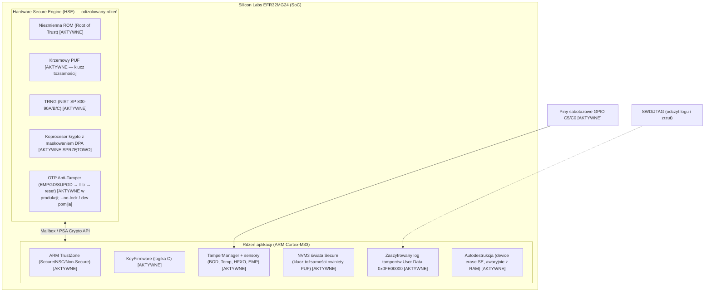

# Zabezpieczenia sprzętowe MCU (EFR32MG24 / Secure Vault High)

> **Kanon krzemu.** To jedyne miejsce opisujące, co daje sam układ i który mechanizm sprzętowy jest aktywny. Szczegóły detekcji tamper — [`antitamper.md`](antitamper.md); klucze i PUF w użyciu — [`cryptography-and-keys.md`](cryptography-and-keys.md); blokada SWD — [`secure_debug_lock.md`](secure_debug_lock.md).
>
> **Źródło prawdy:** kod firmware (`KeyFirmware`) + dokumentacja Silicon Labs (karta katalogowa EFR32MG24, AN1247). Przy rozbieżności wygrywa kod.

Klucz sprzętowy bazuje na module **Seeed Studio XIAO MG24** (SoC **Silicon Labs EFR32MG24B220F1536IM48**, rodzina Wireless Gecko Series 2). Układ ma pakiet **Secure Vault™ High**, certyfikowany **PSA Certified Level 3**. Poniżej status wdrożenia każdej funkcji: **[AKTYWNE]**, **[AKTYWNE SPRZĘTOWO]** (autonomiczna cecha krzemu), **[software]** lub **[NIEWYKORZYSTANE]**.

## Status funkcji Secure Vault™ High

| # | Funkcja | Status | Uwagi |
|:--:|---|---|---|
| 1 | **Hardware Secure Engine (HSE)** | `[AKTYWNE]` | Odizolowany koprocesor (własny CPU/ROM/RAM/Flash). Firmware używa PSA Crypto + SE Manager; wszystkie operacje ECC P-256/ECDHE/AES-256-GCM/HKDF/AES-128 liczy HSE. |
| 2 | **PUF + Key Wrapping** | `[AKTYWNE]` | PUF odtwarzany przy starcie z losowych stanów SRAM, niedostępny dla Cortex-M33. Owija **klucz tożsamości** (`IDENTITY_KEY_ID=0x81001`, `SL_PSA_KEY_LOCATION_WRAPPED`) → kopia flasha na innym chipie nie przejdzie handshake. Mechanizm i inne klucze: [`cryptography-and-keys.md`](cryptography-and-keys.md). |
| 3 | **Przeciwdziałanie DPA** | `[AKTYWNE SPRZĘTOWO]` | Maskowanie poboru prądu, clock jitter, maskowanie operandów AES/ECC — wbudowane w krzem HSE, niezależne od kodu. |
| 4 | **TRNG** | `[AKTYWNE]` | Entropia z szumu termicznego (NIST SP 800-90A/B/C). Zasila klucze efemeryczne ECDHE, sól HKDF, tokeny VRX. |
| 5 | **Sensor napięcia (supply glitch, SE 18 `SUPGD`)** | `[AKTYWNE — OTP uzbrojone + software log-only]` | SE 18 uzbrojony w OTP (filtr→licznik→reset) na donglach produkcyjnych. Programowy detektor BOD jest tylko-log (próg `0xFFFFFFFF`). Progi i reakcje: [`antitamper.md`](antitamper.md). |
| 6 | **Detektor taktowania/logiki (digital glitch, SE 17 `EMPGD`)** | `[AKTYWNE — OTP uzbrojone + software log-only]` | SE 17 uzbrojony w OTP (filtr→reset). Programowy detektor HFXO0 tylko-log. Szczegóły: [`antitamper.md`](antitamper.md). |
| 7 | **Sensory temperatury** | `[AKTYWNE — software]` | Celowo software: `EMU_TemperatureGet()` co 5 s, granice −10°C/+70°C, próg 12 odczytów (≈60 s). Czujnik SE 22 zostawiony `IGNORE`. Szczegóły: [`antitamper.md`](antitamper.md). |
| 8 | **Detektor EMP** | `[AKTYWNE — OTP uzbrojone (SE 17)]` | Realny EMP łapie uzbrojony SE 17. Programowa ścieżka `TAMPER_TYPE_EMP` jest **martwa** (brak źródła sprzętowego). |
| 9 | **Flash Code Zeroization / autodestrukcja** | `[AKTYWNE]` | `sl_se_erase_device()` (awaryjnie funkcja RAM) kasuje cały Flash+RAM i odblokowuje debug — **to nie bric**, dongle flashuje się od nowa. Log na stronie User Data zostaje. Szczegóły: [`antitamper.md`](antitamper.md). |
| 10 | **Secure Boot (RTSL)** | `[WYŁĄCZONY — trwała decyzja zespołu]` | `enable_secure_boot=false` wypalane **nieodwracalnie** w OTP (`sl_se_init_otp()`, `sec_tamper_otp.c`, w kroku pieczętowania). Świadomie: redundantny z Secure Debug Lockiem (atakujący i tak nie otworzy SWD, by wgrać złe firmware), a pozwala swobodnie flashować dev. **NIE do włączenia później.** |
| 11 | **Secure Debug Lock** | `[ZAIMPLEMENTOWANE — domyślne w provisioningu]` | Blokada SWD przez SE Manager (RPC `0x60-0x63`), odblokowanie challenge-response do resetu, jedyny sekret = Command Key. Pełny opis: [`secure_debug_lock.md`](secure_debug_lock.md). |
| 12 | **Attestation fabryczna Silicon Labs** | `[NIEWYKORZYSTANE]` | Tożsamość weryfikuje własne PKI producenta (Root CA → certyfikat w NVM3); certyfikat fabryczny SiLabs nie jest odpytywany. |
| 13 | **Izolacja ARM TrustZone (Cortex-M33)** | `[AKTYWNE]` | SAU dzieli Flash/RAM na Secure/NSC/Non-Secure. Secure izoluje algorytmy Compass IP, krypto, RTC, limit użytkowników i TamperManager; Non-Secure obsługuje cJSON i TinyFrame/USB przez bramki NSC z walidacją CMSE. |

## Pętla antysabotażowa (piny obudowy)

Piny **PC5** (`TAMPER1`) i **PC0** (`TAMPER2`) w trybie `SL_GPIO_MODE_INPUT_PULL_FILTER`. Zamknięta obudowa zwiera pin do GND (stan `0`); przerwanie pętli → pull-up podnosi do `1`. GPIO portu C nie budzi z EM2, więc firmware **odpytuje co 1 s** (`sl_sleeptimer`), zgłaszając przez bramkę NSC do `tamper_manager_detected()` (próg **1**). Pełny opis reakcji i logu: [`antitamper.md`](antitamper.md).
