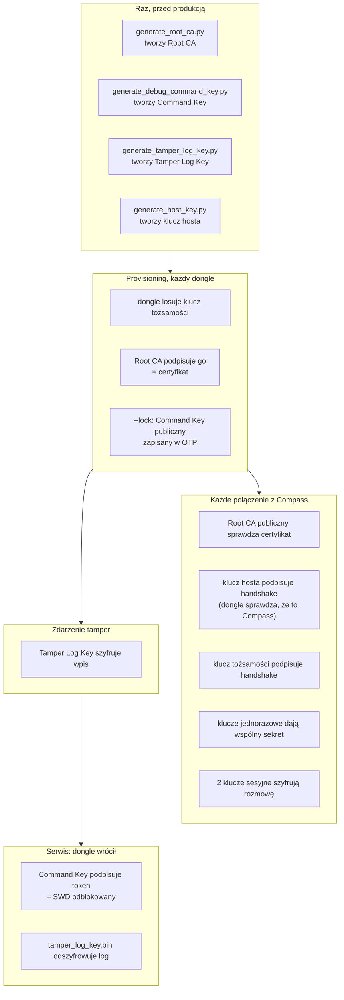
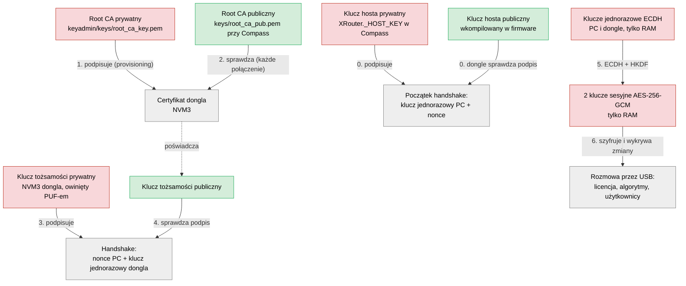
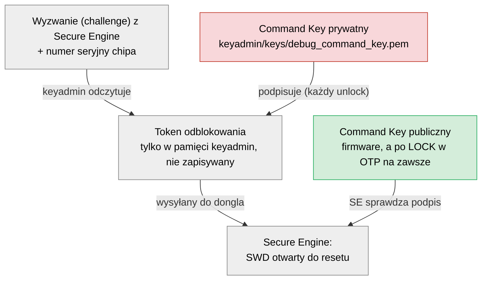
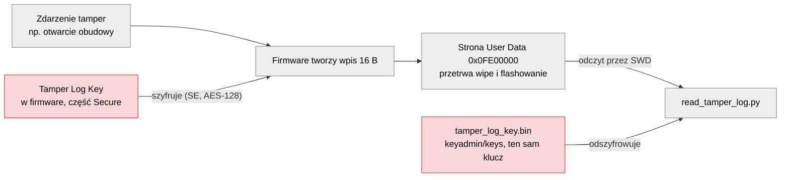
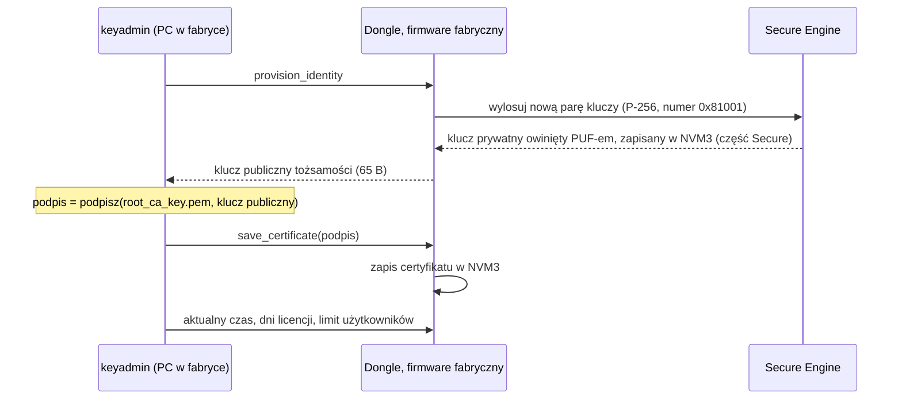
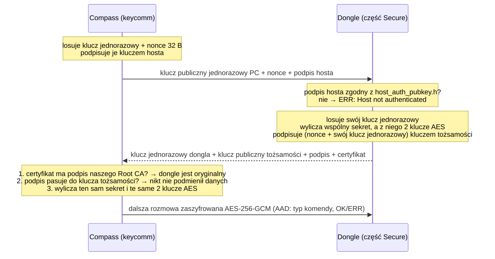

# Klucze: skąd się biorą i do czego służą

Ten dokument opisuje każdy klucz w systemie Compass + KeySec + KeyFirmware: kto go tworzy, kiedy, gdzie leży i do czego jest potrzebny. Stan zgodny z kodem z 2026-10-30.

Klucze dzielą się na trzy grupy:

1. **Klucze fabryczne.** Tworzysz je raz, u siebie na komputerze. Są wspólne dla wszystkich dongli.
2. **Klucze dongla.** Powstają podczas provisioningu. Każdy dongle ma własne.
3. **Klucze sesyjne.** Powstają przy każdym połączeniu Compass z donglem i istnieją tylko w pamięci RAM.

Dwa pojęcia, które przewijają się dalej:

* **Para kluczy do podpisu** (ECDSA P-256) składa się z klucza prywatnego i publicznego. Kluczem prywatnym się podpisuje i trzeba go trzymać w tajemnicy. Kluczem publicznym każdy może sprawdzić, czy podpis jest prawdziwy, więc nie musi być tajny.
* **Klucz symetryczny** (AES) to jeden klucz, który służy i do szyfrowania, i do odszyfrowania. Obie strony muszą mieć ten sam.

---

## 1. Mapa kluczy w skrócie

Kluczy jest dużo, ale tworzą tylko **trzy niezależne łańcuchy**. Każdy chroni co innego i nie zależy od pozostałych:

| Łańcuch | Pytanie, na które odpowiada | Klucze |
|---|---|---|
| **A. Połączenie z Compass** | „Czy to oryginalny dongle, czy po drugiej stronie jest Compass i czy nikt nie podsłuchuje?” | Root CA, klucz tożsamości, certyfikat, klucz hosta, klucze jednorazowe, klucze sesyjne |
| **B. Port SWD** | „Czy to producent chce odblokować chip?” | Command Key |
| **C. Log tamperów** | „Co się działo z donglem? (i żeby nikt obcy tego nie przeczytał)” | Tamper Log Key |

Kolory na diagramach: **czerwony** = tajny klucz (prywatny albo symetryczny), **zielony** = klucz publiczny (może być jawny), **szary** = dane lub miejsce.

### 1.1 Kiedy który klucz jest używany



To samo w tabeli (co robi klucz w danym momencie):

| Klucz | Przed produkcją | Provisioning | Każde połączenie | Zdarzenie tamper | Serwis |
|---|---|---|---|---|---|
| Root CA prywatny | tworzony | **podpisuje** klucz tożsamości | – | – | – |
| Root CA publiczny | tworzony | sprawdzany (pasuje do prywatnego?) | **sprawdza** certyfikat | – | – |
| Klucz tożsamości prywatny | – | tworzony w donglu | **podpisuje** handshake | – | – |
| Klucz tożsamości publiczny + certyfikat | – | tworzone, zapisane w NVM3 | wysyłane do PC, **sprawdzane** | – | – |
| Klucze jednorazowe ECDH | – | – | tworzone, dają wspólny sekret, kasowane | – | – |
| Klucze sesyjne AES | – | – (tylko test w kroku 5) | tworzone, **szyfrują** rozmowę | – | – |
| Command Key prywatny | tworzony | – | – | – | **podpisuje** token odblokowania (w pamięci, przy każdym unlocku) |
| Command Key publiczny | tworzony, wkompilowany | **zapisany w OTP** (`--lock`) | – | – | SE nim **sprawdza** token |
| Klucz hosta prywatny | tworzony, wpisany w Compass (`XRouter._HOST_KEY`) | keyadmin **podpisuje** handshake (krok 5) | Compass **podpisuje** handshake | – | keyadmin **podpisuje** handshake |
| Klucz hosta publiczny | tworzony, wkompilowany | – | dongle **sprawdza** podpis | – | dongle **sprawdza** podpis |
| Tamper Log Key | tworzony, wkompilowany | – | – | **szyfruje** wpis | **odszyfrowuje** log (plik `.bin`) |

### 1.2 Łańcuch A: połączenie z Compass



Krok 0 mówi donglowi: „to Compass (albo nasz keyadmin), a nie obcy program”; bez niego dongle nie otwiera sesji. Kroki 2 i 4 mówią Compass: „to oryginalny dongle i nikt nie siedzi pośrodku”. Krok 6 sprawia, że podsłuch USB nic nie daje.

### 1.3 Łańcuch B: odblokowanie portu SWD



### 1.4 Łańcuch C: log tamperów



---

## 2. Wszystkie klucze w jednej tabeli

| Klucz | Rodzaj | Kiedy i gdzie powstaje | Gdzie leży | Do czego służy |
|---|---|---|---|---|
| **Root CA, prywatny** | para do podpisu (część prywatna) | Raz, skrypt `keyadmin/scripts/generate_root_ca.py` | `KeySec/keyadmin/keys/root_ca_key.pem` (bez hasła) | To „pieczątka fabryki”. Przy provisioningu keyadmin podpisuje nim klucz publiczny nowego dongla, a ten podpis staje się certyfikatem dongla. Tylko dongle z takim podpisem są przez Compass uznawane za oryginalne. Klucz potrzebny jest tylko w fabryce i nigdy nie trafia do klienta ani do dongla. |
| **Root CA, publiczny** | para do podpisu (część publiczna) | Razem z prywatnym | `keyadmin/keys/root_ca_pub.pem` i `keycomm/keys/root_ca_pub.pem`. Compass szuka go w folderze `keys/` obok exe. | Compass sprawdza nim „pieczątkę” przy każdym połączeniu. Jeśli certyfikat dongla nie był podpisany naszym Root CA, Compass odrzuca dongle. Chroni to przed podróbką, czyli innym urządzeniem udającym nasz dongle. Provisioning porównuje go z kluczem prywatnym, żeby nie wyprodukować dongli, których Compass nie zaakceptuje. |
| **Klucz tożsamości dongla, prywatny** | para do podpisu (część prywatna) | Provisioning, krok 3. Dongle sam go losuje na polecenie `provision_identity` (generator liczb losowych w Secure Engine). | Pamięć NVM3 dongla, w części chronionej (świat Secure, klucz PSA o numerze `0x81001`). Jest **owinięty PUF-em** (lokalizacja `SL_PSA_KEY_LOCATION_WRAPPED`): w NVM3 leży tylko szyfrogram, który działa wyłącznie na tym chipie. Dotyczy dongli provisionowanych firmware z tą zmianą; starsze mają klucz jawny do ponownego provisioningu. Firmware nigdy go nie wysyła. | To „dowód osobisty” dongla. Dzięki owinięciu PUF-em kopia flasha przeniesiona na inny chip (albo do emulatora na PC) nie przejdzie handshake, więc dongla nie da się sklonować. Przy każdym połączeniu dongle podpisuje nim dane z handshake. Compass sprawdza ten podpis i wie, że rozmawia z tym konkretnym donglem, a nie z kimś, kto podsłuchał i podmienił dane po drodze (atak man-in-the-middle). Bez tego klucza dongle nie zestawi szyfrowanego połączenia i Compass nie zadziała. Kasuje go wipe; wtedy dongle trzeba provisionować od nowa. |
| **Klucz tożsamości dongla, publiczny** | para do podpisu (część publiczna) | Wyliczany z prywatnego. Przy provisioningu dongle wysyła go do keyadmin. | Wyliczany z klucza prywatnego w NVM3. Dongle wysyła go przy każdym połączeniu. | Przy provisioningu fabryka go podpisuje (powstaje certyfikat). Przy połączeniu Compass najpierw sprawdza, czy ten klucz ma fabryczny podpis, a potem sprawdza nim podpis dongla z handshake. |
| **Certyfikat dongla** | podpis (do 72 B) | Provisioning, krok 3: keyadmin podpisuje kluczem Root CA klucz publiczny tożsamości (65 B) i odsyła podpis do dongla | NVM3 dongla. Dongle wysyła go przy każdym połączeniu. | Łączy klucz tożsamości dongla z naszą fabryką: „ten klucz publiczny należy do oryginalnego dongla”. Sam nie jest tajny: skopiowany do innego urządzenia jest bezużyteczny bez klucza prywatnego, który zostaje w donglu. |
| **Klucze jednorazowe połączenia** (po jednym w PC i w donglu) | para do uzgodnienia klucza (ECDH P-256) | Przy każdym połączeniu, po obu stronach, losowane od nowa | Tylko RAM. Kasowane zaraz po użyciu. | Pozwalają PC i donglowi uzgodnić wspólny sekret, choć wymieniają tylko klucze publiczne. Ktoś, kto podsłucha cały USB, nie wyliczy z nich tego sekretu. Ponieważ są losowane od nowa przy każdym połączeniu, wyciek klucza z jednej sesji nie odszyfruje innych sesji. |
| **Klucze sesyjne** (2 sztuki) | symetryczne AES-256-GCM | Przy każdym połączeniu: wyliczane ze wspólnego sekretu (HKDF-SHA256), z losową liczbą od PC (nonce 32 B) jako solą | RAM w PC i w donglu. Giną po rozłączeniu, resecie albo nowym handshake. | Szyfrują całą rozmowę Compass z donglem: sprawdzanie licencji, obliczenia algorytmów, limity użytkowników. Jeden klucz jest do wysyłania PC → dongle (`KEYSEC_CLIENT_WRITE_KEY_V1`), drugi dongle → PC (`KEYSEC_SERVER_WRITE_KEY_V1`). GCM wykrywa też każdą zmianę wiadomości po drodze, łącznie z numerem komendy i statusem OK/ERR, które leżą poza szyfrogramem (są dołączone jako AAD). Błędy też idą zaszyfrowane; jawne są tylko `ERR: Secure Session Not Active` (nie ma jeszcze kluczy) i `ERR: Encrypt Failed`, a keycomm reaguje na nie wyłącznie nowym handshake. Licznik w każdej wiadomości nie pozwala odtworzyć starej, nagranej wiadomości. Bez tych kluczy podsłuch USB pokazałby wyniki obliczeń i polecenia. |
| **Command Key, prywatny** | para do podpisu (część prywatna) | Raz, skrypt `keyadmin/scripts/generate_debug_command_key.py` | `keyadmin/keys/debug_command_key.pem` | „Klucz serwisowy” do zablokowanego portu SWD (programowanie i debugowanie). Przy każdym odblokowaniu keyadmin podpisuje nim (w pamięci) token dla danego chipa. Bez tego podpisu Secure Engine zablokowanego dongla nie otworzy portu SWD, więc nie da się odczytać pamięci, wgrać nowego firmware ani przeczytać logu tamperów przez SWD. Jest jeden dla wszystkich dongli. |
| **Command Key, publiczny** | para do podpisu (część publiczna) | Razem z prywatnym. Skrypt zapisuje go też jako nagłówek C. | `keyadmin/keys/debug_command_pubkey.pem` oraz `KeyFirmware/src/secure/debug_command_pubkey.h` (wkompilowany w firmware). Po LOCK trafia też do pamięci **OTP** dongla, na zawsze. | Przy LOCK firmware zapisuje go w OTP. Od tej chwili Secure Engine tego chipa akceptuje tylko polecenie odblokowania podpisane pasującym kluczem prywatnym. Jest wkompilowany, a nie przyjmowany z PC, więc nikt nie może podsunąć donglowi własnego klucza. Z OTP nie da się go usunąć ani zmienić. |
| **Klucz hosta, prywatny** | para do podpisu (część prywatna) | Raz, skrypt `keyadmin/scripts/generate_host_key.py` | Pole `XRouter._HOST_KEY` w `compass/app/level_x/xrouter.py` (wkompilowane w exe Compass, chronione Themidą) oraz kopia fabryczna `keyadmin/keys/host_key.pem` dla keyadmin | Compass podpisuje nim każdy handshake (klucz jednorazowy PC + nonce). Dzięki temu dongle wie, że połączenie idzie z Compass, a nie z obcego programu, który odtworzył protokół. Nagranie handshake nic nie daje: do kluczy sesji potrzebny jest prywatny klucz jednorazowy PC. Jeden klucz dla wszystkich kopii Compass: ktoś, kto wydobędzie go z exe, może się podszyć pod Compass, ale licencji i limitu użytkowników nadal pilnuje dongle. |
| **Klucz hosta, publiczny** | para do podpisu (część publiczna) | Razem z prywatnym; skrypt zapisuje go jako nagłówek C | `KeyFirmware/src/core/crypto/host_auth_pubkey.h` (wkompilowany w część Secure firmware) | Dongle sprawdza nim podpis hosta na początku handshake. Bez poprawnego podpisu odpowiada `ERR: Host not authenticated` i nie otwiera sesji. |
| **Tamper Log Key** | symetryczny AES-128 | Raz, skrypt `keyadmin/scripts/generate_tamper_log_key.py` | `keyadmin/keys/tamper_log_key.bin` oraz `KeyFirmware/src/core/tamper_log_key.h` (wkompilowany w część Secure firmware) | Szyfruje log zdarzeń tamper (otwarcie obudowy, przecięcie ścieżki, skoki napięcia, temperatura…). Log leży na stronie User Data, której nie kasuje nawet wipe. Po wipe port SWD jest otwarty i każdy może przeczytać tę stronę, ale zobaczy tylko zaszyfrowane bajty. My odczytujemy log przez `read_tamper_log.py`, który odszyfrowuje go plikiem `tamper_log_key.bin`. Dowiadujemy się z niego, co się działo z donglem, który wrócił od klienta. |
| **PUF** (klucz główny chipa) | fizyczna cecha krzemu (SRAM PUF) | Nigdzie nie powstaje: Secure Engine odtwarza go przy każdym starcie z drobnych, przypadkowych różnic w krzemie, inny w każdym chipie | Nigdzie nie jest zapisany. Istnieje tylko wewnątrz Secure Engine; nie odczyta go ani SWD, ani nasz firmware | Secure Engine może nim „owijać” (szyfrować) inne klucze, żeby leżały we flashu jako szyfrogram działający tylko na tym jednym chipie (klucze typu wrapped, `SL_PSA_KEY_LOCATION_WRAPPED`). **Używa go tylko klucz tożsamości dongla**, jedyny klucz, który leży trwale w donglu i nigdy nie jest potrzebny poza nim. Tamper Log Key celowo go nie używa, bo log odszyfrowujemy na PC. |

Inne losowe wartości (to nie klucze, ale też są tajne lub jednorazowe):

* **Token VRX.** 32 losowe bity (`psa_generate_random`) na zadanie każdego użytkownika, tylko w RAM dongla (`security_users.c`). Dongle wydaje go przy sprawdzeniu licencji (`MSG_CHECK_LIC`) i wymaga go przy obliczeniach. Razem z tablicą aktywnych użytkowników (ostatnie 10 minut) pilnuje limitu użytkowników w samym donglu: algorytmy w świecie Secure same sprawdzają licencję, limit i token. Błędny token jest zapisywany jako zdarzenie tamper.
* **Nonce hosta.** 32 losowe bajty, które PC wysyła przy każdym połączeniu. Dongle musi je podpisać, więc nagranego starego handshake nie da się odtworzyć. Są też solą przy wyliczaniu kluczy sesyjnych.

---

## 3. Przed provisioningiem: klucze fabryczne

Tworzysz je raz na całą produkcję. Każdy skrypt odmawia nadpisania istniejącego klucza, żeby nie dało się go przypadkiem zgubić.

| Kolejność | Polecenie (w `KeySec/`) | Co tworzy | Czy trafia do firmware? |
|---|---|---|---|
| 1 | `python keyadmin/scripts/generate_root_ca.py` | `root_ca_key.pem` i `root_ca_pub.pem` (w `keyadmin/keys` i `keycomm/keys`) | Nie. Dongle przechowuje tylko podpis (certyfikat), a sam Root CA nie jest mu potrzebny. |
| 2 | `python keyadmin/scripts/generate_debug_command_key.py` | `debug_command_key.pem`, `debug_command_pubkey.pem`, `debug_command_pubkey.h` | Tak, część publiczna. |
| 3 | `python keyadmin/scripts/generate_tamper_log_key.py` | `tamper_log_key.bin`, `tamper_log_key.h` | Tak, klucz AES. |
| 4 | `python keyadmin/scripts/generate_host_key.py` | `host_key.pem`, `host_auth_pubkey.h` i pole `XRouter._HOST_KEY` w Compass | Tak, część publiczna; część prywatna trafia do Compass. |

Po krokach 2, 3 i 4 firmware trzeba przebudować (`compile.bat`); po kroku 4 także Compass. `provision_dongle.py` robi to sam, chyba że podasz `--skip-compile`.

---

## 4. Provisioning: `provision_dongle.py`

```
python keyadmin/scripts/provision_dongle.py [dni] [użytkownicy] [--lock]
```

| Krok | Co się dzieje | Jakie klucze |
|---|---|---|
| 0. kontrola | Same odczyty, nic nie jest zmieniane | Sprawdza, czy `root_ca_key.pem` pasuje do `keycomm/keys/root_ca_pub.pem`. Przy `--lock` sprawdza też, czy Command Key w firmware pasuje do pliku. |
| 1. kompilacja | `compile.bat` buduje dwa firmware: produkcyjny `keyfirmware.hex` i fabryczny `keyfirmware_prov.hex` | Wkompilowuje publiczny Command Key i Tamper Log Key. |
| 2. firmware fabryczny | `set_factory_mode.bat` | Firmware fabryczny ma komendy admina (data, licencja, użytkownicy, wipe, tożsamość). Rozmowa jest **jawna**, bo dongle nie ma jeszcze certyfikatu, więc nie da się zestawić szyfrowanego połączenia. |
| 3. sekrety | Patrz diagram niżej | **Dongle tworzy swój klucz tożsamości, a fabryka go podpisuje.** Potem zapisywane są: aktualny czas, liczba dni licencji i limit użytkowników. |
| 4. firmware produkcyjny | `set_production_mode.bat` | Firmware produkcyjny nie ma komend admina. Pamięć NVM3 (klucz tożsamości, certyfikat, licencja) zostaje. |
| 5. sprawdzenie | Pełne połączenie tak jak w Compass, sprawdzenie licencji, `alg1(15,27)=42`, próba wipe musi zostać odrzucona | Pierwsze prawdziwe użycie klucza tożsamości, certyfikatu, publicznego Root CA i klucza hosta (keyadmin podpisuje kopią z `host_key.pem`). Powstają pierwsze klucze sesyjne. |
| 6. `--lock` (opcjonalnie) | Secure Debug Lock | **Publiczny Command Key trafia do OTP** (na zawsze), a port SWD zostaje zablokowany. |

### Krok 3 dokładniej



Każde `provision_identity` kasuje stary klucz tożsamości i tworzy nowy. Stary certyfikat przestaje wtedy pasować, więc krok 3 zawsze zapisuje też nowy certyfikat.

---

## 5. Jak klucze działają w codziennej pracy

### 5.1 Połączenie Compass z donglem (handshake)

Kod: `KeySec/keycomm/core/secure_channel.py` (PC) i `KeyFirmware/src/core/crypto/session_ecdhe.c` (dongle). Compass szuka `root_ca_pub.pem` w `keys/` lub `keycomm/keys/`, obok exe albo w bieżącym folderze (`compass/app/level_x/xrouter.py`).



Po kolei, prostymi słowami:

0. Compass podpisuje swój klucz jednorazowy kluczem hosta. Dongle sprawdza podpis i rozmawia tylko z Compass (i keyadmin).
1. PC i dongle wymieniają klucze jednorazowe i z nich obie strony wyliczają ten sam sekret. Podsłuchujący go nie wyliczy.
2. Dongle podpisuje swoją część kluczem tożsamości, więc PC wie, że rozmawia z prawdziwym donglem, a nie z pośrednikiem.
3. Certyfikat dowodzi, że ten klucz tożsamości wystawiła nasza fabryka.
4. Ze wspólnego sekretu powstają dwa klucze AES. Nimi szyfrowana jest cała dalsza rozmowa.

Nowe klucze sesyjne powstają przy każdym połączeniu. Powstają też wtedy, gdy keycomm dostanie błąd sesji albo nie odszyfruje odpowiedzi (`protocol.py` robi wtedy ponowny handshake). Nie ma okresowej wymiany kluczy co minutę, choć opisuje ją starszy dokument `cryptography_flow_and_keys.md`.

### 5.2 Odblokowanie portu SWD (Secure Debug)

Szczegóły: [secure_debug_lock.md](secure_debug_lock.md#3-keys-and-files).

1. LOCK zapisuje publiczny Command Key w OTP. Od tej chwili chip ufa tylko temu kluczowi.
2. Przy odblokowaniu dongle podaje numer seryjny chipa i wyzwanie (challenge) z Secure Engine. Keyadmin buduje z Command Key token odblokowania (w pamięci), wysyła go i od razu o nim zapomina. Token nie trafia na dysk; keyadmin dopisuje tylko zdarzenie UNLOCK do `device.json` (plik na PC z historią operacji keyadmin na tym donglu, nie log tamperów).
3. Secure Engine sprawdza token kluczem z OTP i otwiera SWD do najbliższego resetu.
4. **Jedynym sekretem jest Command Key.** Wyzwania nie rolujemy: token pasowałby do tego chipa dalej, ale nigdzie nie jest zapisywany i powstaje tylko w fabryce.

### 5.3 Log tamperów

Szczegóły: [antitamper.md](antitamper.md#persistent-tamper-log-user-data-page).

1. Gdy coś się dzieje (np. otwarcie obudowy), dongle zapisuje 16-bajtowy wpis, wcześniej szyfrując go kluczem Tamper Log Key.
2. Wpis trafia na stronę User Data `0x0FE00000`. Tej strony nie kasuje ani wipe, ani flashowanie.
3. W serwisie keyadmin czyta stronę przez SWD (`read_tamper_log.py`) i odszyfrowuje ją plikiem `tamper_log_key.bin`.

---

## 6. Co się dzieje z kluczami przy wipe, flashowaniu i odblokowaniu

| Klucz | Wipe (tamper) lub pełne kasowanie chipa | Wgranie nowego firmware | Odblokowanie SWD |
|---|---|---|---|
| Klucz tożsamości + certyfikat (NVM3) | **Kasowane.** Dongle trzeba provisionować od nowa. | Zostają (flashowanie nie rusza NVM3) | Zostają |
| Licencja, czas, limit użytkowników (NVM3) | Kasowane | Zostają | Zostają |
| Tamper Log Key (w firmware) | Kasowany razem z firmware | Wraca z nowym firmware (ten sam, jeśli pliku nie zmieniano) | Zostaje |
| Publiczny Command Key w firmware | Kasowany | Wraca z nowym firmware | Zostaje |
| Publiczny klucz hosta w firmware | Kasowany | Wraca z nowym firmware | Zostaje |
| Publiczny Command Key w **OTP** | **Zostaje na zawsze** | Zostaje | Zostaje |
| Log tamperów (User Data) | **Zostaje** | Zostaje | Zostaje |
| Klucze sesyjne (RAM) | Giną | Giną | Giną |

---

## 7. Które pliki trzeba chronić i mieć w kopii zapasowej

| Plik | Co się stanie, gdy go zgubisz | Co się stanie, gdy ktoś go ukradnie |
|---|---|---|
| `keyadmin/keys/root_ca_key.pem` | Nie wyprodukujesz nowych dongli, które zaakceptuje obecny Compass. Trzeba by zrobić nowy Root CA i wydać nowy Compass. | Ktoś może podpisać własne urządzenie, a Compass uzna je za oryginalny dongle. |
| `keyadmin/keys/debug_command_key.pem` | Zablokowane nim dongle da się odzyskać tylko pełnym kasowaniem chipa (traci się licencję i tożsamość). | Ktoś może odblokować SWD każdego dongla zablokowanego tym kluczem. |
| `keyadmin/keys/tamper_log_key.bin` | Nie odczytasz logów tamperów z dongli, które już są u klientów. | Ktoś może odczytać logi tamperów. |
| `keyadmin/keys/host_key.pem` (i to samo w `XRouter._HOST_KEY`) | Kopię odtworzysz z `xrouter.py`. Gdy zginą obie, nowy klucz wymaga przeflashowania wszystkich dongli i nowego wydania Compass. | Ktoś może napisać własny program, który dongle uzna za Compass (licencja i limit użytkowników dalej działają). |
| `keycomm/keys/root_ca_pub.pem` | Odtworzysz go z `root_ca_key.pem`. | Nic się nie stanie, to klucz publiczny. |

Obecne klucze w `keyadmin/keys/` to **klucze deweloperskie** i leżą w git. Przed prawdziwą produkcją wygeneruj nowe, trzymaj je poza repo i zrób kopię offline. Procedura dla Command Key: [secure_debug_lock.md](secure_debug_lock.md#5-regenerating-rotating-the-command-key).

---

## 8. Czym ten opis różni się od `cryptography_flow_and_keys.md`

Starszy dokument opisuje plan, a nie obecny kod. Różnice:

* **Klucz tożsamości owinięty PUF-em:** starszy dokument to zakładał, kod robi to od 2026-10-30 (`SL_PSA_KEY_LOCATION_WRAPPED` w `auth_manager.c`). Dongle provisionowane wcześniej mają klucz jawny do czasu ponownego provisioningu.
* **Nie ma wymiany kluczy sesyjnych co minutę.** Nowy handshake jest tylko przy połączeniu i po błędzie.
* **Klucz publiczny Root CA nie jest wkompilowany w Compass.** To plik `root_ca_pub.pem` w `keys/` obok exe.
* **Certyfikat to sam podpis Root CA** nad kluczem publicznym tożsamości, bez dodatkowych pól.

## Gdzie jest kod

| Obszar | Pliki |
|---|---|
| Tworzenie kluczy fabrycznych | `KeySec/keyadmin/scripts/generate_root_ca.py`, `generate_debug_command_key.py`, `generate_tamper_log_key.py`, `generate_host_key.py` |
| Provisioning | `KeySec/keyadmin/scripts/provision_dongle.py` |
| Handshake po stronie PC | `KeySec/keycomm/core/secure_channel.py`, `KeySec/keycomm/api/device_discovery.py`, klucz hosta: `compass/app/level_x/xrouter.py`, `KeySec/keyadmin/admin_factory.py` |
| Handshake i szyfrowanie po stronie dongla | `KeyFirmware/src/core/crypto/session_ecdhe.c`, `auth_manager.c`, `KeyFirmware/src/core/router_common.c` (AAD, szyfrowane błędy) |
| Szyfrowanie po stronie PC | `KeySec/keycomm/core/protocol.py` (AAD, ponowny handshake) |
| Certyfikat i licencja w NVM3 | `KeyFirmware/src/core/security_nvm.c` |
| Secure Debug | `KeyFirmware/src/secure/sec_debug_lock.c`, `KeySec/keyadmin/secure_debug/` |
| Log tamperów | `KeyFirmware/src/core/tamper_manager.c`, `KeySec/keyadmin/secure_debug/tamper_log_decoder.py` |
