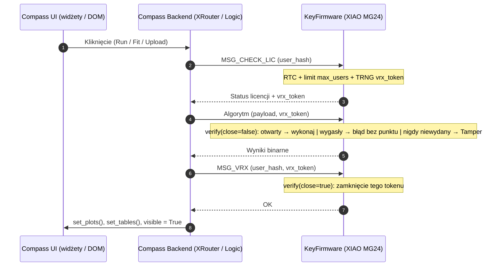

# Mechanizm limitu aktywnych użytkowników (okno 10-minutowe)

## 1. Przegląd
Aplikacja Compass działa jako serwer WWW oparty na Tornado. Ponieważ wielu użytkowników może łączyć się przez sesje przeglądarki, system musi twardo ograniczać maksymalną liczbę *jednocześnie aktywnych użytkowników*. Użytkownik jest uznawany za „aktywnego” tylko wtedy, gdy korzystał z aplikacji w ciągu ostatnich **10 minut** (600 sekund).

> **Stan wdrożony (2026-11-13):** egzekwowanie limitu to w istocie **Wariant 2** — dongle trzyma w RAM tablicę `ActiveUser { uint32_t user_hash; uint32_t last_seen; }` (`KeyFirmware/src/core/security_users.c`), liczy aktywnych w oknie 600 s i w `security_users_register_activity()` odrzuca żądanie (`CORE_ERR_USER_LIMIT_EXCEEDED`), gdy liczba aktywnych osiągnie skonfigurowany limit (wartość z NVM, `security_nvm_load_max_users()`; twardy sufit `MAX_TRACKED_USERS` = 100 — stałej `MAX_USERS` w kodzie nie ma). Struktura `ActiveUser` i tablica `active_users[]` **istnieją w kodzie** i są rdzeniem egzekwowania. Tokeny **VRX** (`nsc_generate_vrx_token` / `nsc_verify_vrx_token`, komenda `MSG_VRX`) to **dodatkowa warstwa** wiążąca bloki licencyjne (anti-replay). Historyczne są wyłącznie **nazwy komend** `MSG_COMPASS_ALG1` i `MSG_REQUEST_SESSION` — tych nie ma w kodzie. Sekcje poniżej zostają jako kontekst decyzji projektowej.

## 2. Zbieranie danych (aplikacja Compass)
Aby egzekwować tę regułę, backend Compass (przez SessionManager i session_store.json) musi śledzić określone dane telemetryczne dla każdego podłączonego użytkownika:
* **Token sesji / ID użytkownika:** Unikalny identyfikator użytkownika (np. hash SHA-256 jego adresu e-mail lub odcisku przeglądarki - browser fingerprint).
* **Timestamp ostatniej aktywności (last_seen_at):** Unix timestamp aktualizowany przy każdym wywołaniu API lub interakcji z UI w ramach danej sesji.

## 3. Warianty egzekwowania (poziomy bezpieczeństwa)

### Wariant 1: egzekwowanie programowe (najsłabsze)
* **Mechanizm:** Compass odczytuje MAX_USERS z dongla KeySec przy starcie. Następnie wewnętrznie filtruje swój session_store.json, licząc sesje, dla których (current_time - last_seen_at) <= 600. Jeśli ich liczba przekroczy limit, UI Compass odrzuca nowe logowania.
* **Podatność:** Atakujący, który rozpakuje plik wykonywalny Nuitki, może wyciąć patchem sprawdzenie if active_count > MAX_USERS. Sprzętowy dongle nie ma pojęcia, ilu użytkowników faktycznie wykonuje obliczenia.

### Wariant 2: egzekwowanie sprzętowe przez blokowanie algorytmów (silne)
* **Mechanizm:** Za liczenie aktywnych użytkowników odpowiada sam dongle.
  - Aplikacja Compass musi dołączać user_id_hash do każdego żądania obliczenia algorytmu (np. MSG_COMPASS_ALG1).
  - Firmware EFR32 utrzymuje wewnętrzną tablicę w RAM: struct ActiveUser { uint32_t user_hash; uint32_t last_seen; };
  - Po otrzymaniu żądania obliczenia dongle aktualizuje last_seen dla danego hasha.
  - Następnie dongle przegląda tablicę i usuwa wszystkie hashe starsze niż 10 minut (korzystając ze swojego zsynchronizowanego Global RTC).
  - Jeśli przyjdzie nowy hash, a tablica zawiera już MAX_USERS aktywnych slotów, dongle zwraca bezwzględny błąd ERR_USER_LIMIT i odmawia wykonania obliczeń.
* **Zaleta:** Nawet jeśli aplikacja Python zostanie całkowicie zdekompilowana i spatchowana, sprzęt fizycznie odmówi obsługi żądań nadmiarowych użytkowników.

### Wariant 3: egzekwowanie sprzętowe z tokenami sesji (najsilniejsze)
* **Mechanizm:** Zamiast wysyłać sam hash, Compass musi jawnie poprosić dongle o „sprzętowy slot sesji” (Hardware Session Slot).
  - Compass wysyła MSG_REQUEST_SESSION (user_id_hash).
  - Dongle sprawdza limit w przesuwnym oknie 10 minut. Jeśli slot jest wolny, generuje tymczasowy 16-bajtowy session_key (przez TRNG, czyli sprzętowy generator liczb losowych w Secure Vault) i go zwraca.
  - Przez kolejne 10 minut wszystkie żądania algorytmów tego użytkownika MUSZĄ być szyfrowane właśnie tym session_key.
  - Po 10 minutach bezczynności dongle po cichu usuwa klucz ze swojej pamięci RAM.
* **Zaleta:** Całkowicie zapobiega atakom typu replay oraz multipleksowaniu Man-in-the-Middle (gdy zhakowana aplikacja hosta próbuje przepuścić wielu użytkowników przez jeden sprzętowy slot sesji).

## 4. Zalecana implementacja
Zdecydowanie zalecamy **Wariant 2** jako podstawę, z możliwością późniejszego przejścia na **Wariant 3**. 
* **Dane do wysłania do KeySec:** user_id_hash (4 bajty) dołączony do payloadu MSG_COMPASS_ALG1.
* **Narzut na RAM sprzętu:** Minimalny. Śledzenie 50 użytkowników wymaga zaledwie 50 * 8 bajtów = 400 bajtów RAM w EFR32.

---

## 5. Autoryzacja zadaniowa: sprzętowa rotacja tokenów VRX (anti-bypass)

Limit użytkowników z §1–§4 egzekwuje dongle, ale żeby zhakowany host nie mógł po prostu **pominąć** sprawdzenia licencji/limitu (inline patching w RAM, wymuszanie skoków, NOP-owanie flagi w Pythonie), każde zadanie wymaga jednorazowego tokenu **VRX** (Verification Token Exchange) wydanego przez dongle. Stan autoryzacji żyje w krzemie, nie w Pythonie.

Implementacja: [`KeyFirmware/src/core/security_users.c`](../../../KeyFirmware/src/core/security_users.c) (`security_generate_vrx_token()` przy `MSG_CHECK_LIC`, `security_verify_vrx_token()` przy algorytmach i `MSG_VRX`).

### 5.1 Przebieg i zasady

1. **Stan w krzemie:** zgoda na wykonanie zależy od dynamicznego tokenu w RAM dongla powiązanego z `user_hash`, nie od flagi w Pythonie.
2. **Kolejność krytyczna (*obliczenia → VRX → frontend*):** żadne tabele ani wykresy nie trafiają do DOM przed potwierdzeniem z dongla. Przerwanie przed `XRouter.vrx()` zostawia UI zablokowane, a dane są niszczone.
3. **Jednorazowość i wykrywanie sabotażu:** `MSG_VRX` (`0x16`) zamyka token bloku. Token nigdy niewydany = zdarzenie tamper (próg 50 — zob. [`antitamper.md`](antitamper.md)): token/parametry zerowe → `VRX_INVALID` (`security_users.c:219-223`), nieznany token aktywnego użytkownika → `VRX_MISMATCH`, brak sesji → `VRX_NO_SESSION`. Token wydany, ale już zamknięty/wyparty → zwykły `ERR: VRX token expired` **bez punktu** (błąd kolejności hosta, nie obejście licencji).
4. **Celowe złamanie DRY:** brak uniwersalnych dekoratorów (pojedynczy punkt podatności). Każdy handler ma jawną sekwencję: `vrx_token: int` wymagany (bez domyślnego `=0`), `XRouter.vrx(vrx_token)` wołane bezwarunkowo.
5. **Wynik firmware** (`nsc_vrx_result_t`): `NSC_VRX_OK`, `NSC_VRX_EXPIRED` (`ERR: VRX token expired`), `NSC_VRX_REJECTED` (zdarzenie tamper, `ERR: Tamper attempt detected...`).

### 5.2 Wiele bloków naraz (od 2026-11-05)

Compass prowadzi równolegle kilka bloków `check_license` → `vrx` jednego użytkownika (asyncio, wątki, benchmark). Dongle trzyma **pulę 32 otwartych tokenów** (wszyscy użytkownicy razem; przy pełnej puli wypada najstarszy) i **listę 32 ostatnio zamkniętych/wypartych**. Otwarty token jest ważny przez cały blok, także gdy użytkownik wypadł z okna 10 min.

* **Porzucone bloki** (błąd lub przerwanie przed `MSG_VRX`): tokeny zostają otwarte i nie wygasają, dopóki w puli są wolne miejsca. Przy pełnej puli nowy `check_license` wypycha najpierw token użytkownika bezczynnego >**180 s** (`VRX_IDLE_EXPIRE_S`, uptime), a gdy takiego nie ma — najstarszy otwarty. Każde użycie tokenu odświeża wszystkie otwarte bloki użytkownika. (Do 2026-11-05 tokeny wygasały po 180 s także przy wolnych miejscach — psuło to bloki liczące długo tylko na hoście, np. `disso_SSD_test_006` ~6 min.)
* **Reakcja na `expired`:** blok nie pokazuje wyniku, ale bramka (`gate_trip`) nie jest wyzwalana (klucz działa). Użytkownik dostaje czerwony toast „Too many simultaneous actions on the key…" (`XRouter.notify_device_limit`).
* Każda instancja `XCall` ([`app/level_x/xcall.py`](../../../compass/app/level_x/xcall.py)) ma **własny** token — bez globalnego „aktywnego bloku". Wywołanie bez bloku (`xcall=None`) otwiera i zamyka własny blok.
* **Powód zmiany:** 2026-11-05 01:28 dwanaście równoległych `_load_heavy_data` (SSD) przejęło token jednego bloku; po jego zamknięciu trzy obliczenia wysłały zamknięty token → 3× `VRX_MISMATCH` i wipe NVM3.
* **Kolejność wdrożenia:** nowy `XCall` wymaga nowego firmware. Ze starym (jeden token na użytkownika) bloki zagnieżdżone nadpisują token i wyzwalają wipe.

### 5.3 Równoległe testy (mode=test, od 2026-11-05)

„Run benchmark" / „Run Full Verification" uruchamiają testy w kilku procesach ([`app/frontend/parallel_test_runner.py`](../../../compass/app/frontend/parallel_test_runner.py)). Port COM otwiera tylko jeden proces, więc komendy z procesów-pracowników idą mostkiem ([`app/level_x/xbridge.py`](../../../compass/app/level_x/xbridge.py)) do procesu głównego pod `XRouter` device lock.

* **Tylko w `mode=test`:** runner, `DongleBridgeServer` i `install_worker_bridge` sprawdzają `app.current_mode`; w innym trybie mostek nie startuje (`PermissionError`), testy idą sekwencyjnie.
* Mostek nasłuchuje na `127.0.0.1`, losowy klucz 32 B ważny jeden przebieg, przepuszcza tylko `check_license`, `vrx` i komendy obliczeń Compass.
* Użytkownik = ten, który uruchomił przebieg (proces główny ustawia tożsamość przed każdą komendą). Każdy blok otwiera/zamyka własny token; mostek nie omija kontroli.

### 5.4 Zabezpieczone punkty wejścia i audyt

| Moduł | Plik | Operacja | Moment VRX |
|---|---|---|---|
| Disso & DissoSSD | `app/frontend/disso_dashboard.py` | `disso_callback`, `on_load` | po `current_calc_task`, przed `set_disso_plots` |
| Safe Space (SSD) | `app/frontend/SSD_dashboard.py` | `run_callback`, `_load_heavy_data` | po `set_safe_space_plots`, przed tabelami |
| PKGE / PKClV1 / Motility | `app/frontend/base_sim_dashboard.py` | `execute_simulation_pipeline` | po `current_calc_task`, przed wykresami 3D |
| Import danych | `app/frontend/load_dashboard.py` | `_process_uploaded_file` | po zapisie pliku, przed widżetami |
| Raport PDF | `app/frontend/report_ui.py` | `_generate_and_update` | po PDF, przed pobieraniem |
| Testy | `test_dashboard.py`, `compass_tests.py` | `run_callback`, klasy `*Test` | po obliczeniach |

Pobranie i zwieńczenie tokenu loguje `keycomm` (`CompassApi`) na konsolę Compass jako `[XROUTER] check_license …` / `[XROUTER] vrx …`. Wykrycie próby ominięcia/modyfikacji tokenu → `status=FAILED (ERR: Tamper attempt detected)` i inkrementacja licznika sabotażu w donglu.
